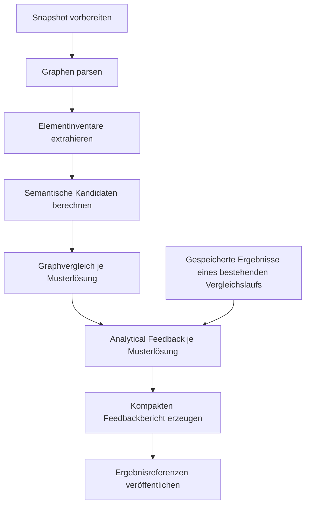

# Konzept: Analytical Feedback Workflow

Stand: 13.11.2026. Historischer Entwurf; das Ausgabeformat wurde inzwischen vereinfacht.
Den tatsächlichen Servicevertrag und Verifikationsstand beschreibt
[Analytical Feedback](../dagu/workflow-services/analytical-feedback/README.md).
Analyse und kompakte Projektion laufen nacheinander im selben Referenz-Unterlauf.
Einziger eigenständiger Workflow ist `model-evaluation-graph-matching`; seine
Modell- und Paarabläufe sind intern eingebettet. Alle Workflowverträge verwenden Version 1.

## 1. Ziel und fachliche Grenze

Der Workflow macht den vorhandenen Graphvergleich nachvollziehbar. Für jedes
Referenz- und Abgabeobjekt beantwortet er: Welches Gegenstück wurde vorgeschlagen,
welche Belege tragen diesen Vorschlag, welche strukturellen Beobachtungen liegen
vor und welche Fragen bleiben offen?

Er erzeugt ein versioniertes `analysis-feedback/v1` und bereitet damit die spätere
Darstellung von Elementprofilen, Modellmarkierungen und Kennzahlen vor. Er trifft
keine zusätzlichen Matchingentscheidungen. Schwellenwerte, Gewichtungen und
Zuordnungsvorschläge bleiben Sache des Matchers. Die erste Ausbaustufe benötigt
weder ein LLM noch weitere Synonymverfahren oder Datenbankänderungen.

Vier Dimensionen bleiben getrennt:

| Dimension | Inhalt |
| --- | --- |
| Identität | Vorläufiger Vorschlag, Alternativen oder ungeklärtes Gegenstück |
| Beschriftung | Exakter Vergleich, Methodenscores und konfigurierte Schwellen |
| Struktur | Typ, Besitzer, Containment und Verbindungsbeziehungen |
| Evidenz | Quellen, Regeln, Voraussetzungen, Gegenbelege und Grenzen |

Eine exakte Beschriftung bestätigt keine fachliche Identität. Eine konsistente
Besitzerzuordnung bestätigt keine unabhängige Containmentprüfung. Ein Score ist
keine Wahrscheinlichkeit. Ein nicht zugeordnetes Objekt gilt als ungeklärt und
nicht automatisch als fehlend oder zusätzlich. `assessmentAvailable` bleibt
`false`; der Workflow vergibt weder Gesamtkorrektheit noch Noten.

## 2. Anschluss an den aktuellen Projektstand

Die folgenden Grundlagen wurden im aktuellen Quellcode und in den bestehenden
Servicebeschreibungen geprüft:

- Der Workflow `model-evaluation-graph-matching` bereitet die Abgabe einmalig vor
  und führt den Vergleich anschließend getrennt je Musterlösung aus.
- Die Dienste lesen einen eingefrorenen `evaluation-input/v1`-Snapshot und
  Workspace-Artefakte. Sie benötigen keinen Datenbankzugriff.
- `reference-comparison/v1` enthält vorläufige Element- und Verbindungszuordnungen,
  Zuordnungsabhängigkeiten, offene Objekte, semantische Evidenz, Typvergleich,
  Besitzerkonsistenz, Containmentbefunde und Verbindungsgruppen nach Endpunkten.
- `feedback-generation` validiert den Vergleich und erzeugt `feedback-report/v1`.
  Das Backend lädt dessen `workflow-result/v1` aus dem jeweiligen Dagu-Unterlauf.
- `Workspace.write()` veröffentlicht atomar und unveränderlich. Identische
  Wiederholungen sind zulässig, abweichende Inhalte am gleichen Pfad nicht.
- Im Parser zeigt eine `contains`-Kante vom **Kind zum Parent**. Verbindungen sind
  Graphknoten der Art `connection`; ihre Endpunkte werden durch `endpoint`-Kanten
  beschrieben. Fachliche Verbindungen dürfen daher nicht als gewöhnliche
  Graphkanten gezählt werden.

Die Zahlen und Retest-Aussagen der gelieferten Analyse dienen als historische
Beispiele. Für dieses Konzept wurden keine gespeicherten Laufartefakte geprüft
und keine neuen Ergebnisse gemessen. Insbesondere sind dokumentierte Prüfungen
mit synthetischen Kandidaten von vollständigen Synonymläufen zu unterscheiden.

## 3. Workflow und Verantwortlichkeiten

Ein neuer Dienst `analytical-feedback` wird als eigener Paarworkflow
`analytical-feedback-pair` in die bestehende Dagu-Orchestrierung eingebunden.
Er besitzt seine eigene fachliche Ausgabe und nutzt das vorhandene Workspace-I/O.

Der neue Hauptschritt heißt `generate_analytical_feedback`. Er folgt auf
`match_graphs` und verwendet zunächst wie die bestehenden Paarvergleiche
`max_concurrent: 1`. Der analytische Dienst arbeitet deterministisch:

1. Snapshot, Modellpaar, Schemas, Herkunft und Hashketten validieren.
2. Graphobjekte und Relationen indexieren, ohne Zuordnungen zu ergänzen.
3. Vorhandene Zuordnungen, Strukturprüfungen und Entscheidungsbelege übernehmen.
4. Belegte Aussagen und explizite Informationslücken erzeugen.
5. Lokale Profile und Gesamtkennzahlen aus denselben Einzelbefunden ableiten.
6. Interne Konsistenz prüfen und das Analyseartefakt atomar veröffentlichen.

Der Zielzustand bietet zwei Sichten auf dieselbe Auswertung:

- `analysis-feedback/v1`: vollständige analytische Profile und Belegreferenzen.
- `feedback-report/v1`: kompakte Projektion der passenden Analysewerte, mit
  unverändertem fachlichem Bedeutungsumfang der bestehenden Felder.

Für die schrittweise Einführung liest `feedback-generation` zunächst weiterhin
den bestehenden Vergleich. Erst nach dem Abgleich der Zähler wird es auf die
analytische Grundlage umgestellt. Dieser Übergang wird nicht zur dauerhaften
zweiten Berechnung von Befunden. Bestehende gespeicherte Berichte bleiben lesbar.

Mehrere Musterlösungen bleiben getrennte Modellpaare. Dieser Workflow kombiniert
keine Treffer unterschiedlicher Referenzen zu einer vermeintlich besten Lösung.

## 4. Eingabe und Veröffentlichung

Der Dienst erhält `WORKFLOW_EVALUATION_ID` und `REFERENCE_KEY`. Der Referenzschlüssel
muss im Snapshot als Musterlösung existieren; `submission` ist keine Referenz.

| Eingabe im Evaluation-Workspace | Zweck |
| --- | --- |
| `inputs/evaluation-input.json` | Modellidentitäten, Sprachressourcen und eingefrorene Konfiguration |
| `graphs/submission.json`, `graphs/<referenceKey>.json` | Vollständige Graphobjekte, Endpunkte und Zugehörigkeiten |
| `labels/submission.json`, `labels/<referenceKey>.json` | Texte und Verfügbarkeit aus `element-inventory/v1` |
| `candidates/<referenceKey>.json` | `semantic-candidates/v1`, Methoden und Scores |
| `comparisons/<referenceKey>.json` | Tatsächliche Vorschläge und Vergleichsbefunde aus `reference-comparison/v1` |

Diese Artefakte bilden den erforderlichen Eingabesatz. Nicht vorhandene optionale
Diagnosefelder eines gültigen Vergleichs führen dagegen zu eingeschränkten
Fähigkeiten und ausdrücklich fehlender Entscheidungsevidenz.

Die vollständige Ausgabe liegt unter
`analysis/<referenceKey>/<analysisKey>.json` im bekannten
`/work/evaluations/<evaluationId>/`-Workspace. `analysisKey` ist ein kanonischer
SHA-256-Hash aus Schema, Eingabehashes, eingefrorener Analysekonfiguration und
`producer.resourceHash`. Dieselben Eingaben mit demselben Dienstcode liefern
denselben Schlüssel und identischen Inhalt.

Der Dienst berechnet den Schlüssel nach der Eingabevalidierung und veröffentlicht
über `Workspace.write()`; der Pfad wird nicht durch eine Veränderung der
allgemeinen Schreibsemantik erzwungen. Geänderter Analysecode erzeugt einen neuen
Pfad. Es gibt keine überschreibbare Datei `latest.json`.

Für die vorhandene Dagu-/API-Anbindung erscheint das Ergebnis zusätzlich im
`workflow-result/v1`-Envelope auf stdout, mit `capability: analytical-feedback`,
`mode: aggregate`, dem Analyseobjekt als `result` und seinem Workspace-Pfad.
Dagu bewahrt dies je Unterlauf als `analysis-result.json` auf. Der Paarworkflow
veröffentlicht `evaluationId`, `referenceKey`, `analysisKey` und `analysisPath`;
die Gesamtübersicht ergänzt die Referenz auf den Analysebereich.

## 5. Datenvertrag `analysis-feedback/v1`

Das Format übernimmt die bestehenden Namen `student` und `reference` für die
beiden Seiten und enthält die folgenden Bereiche:

| Feld | Verbindlicher Inhalt |
| --- | --- |
| `schema` | `analysis-feedback/v1` |
| `status` | `partial`, solange keine vollständige fachliche Bewertung vorliegt |
| `assessmentAvailable` | `false` |
| `evaluationId`, `pair`, `sources` | Evaluation, Referenzschlüssel und eingefrorene Modell-/Versionsidentitäten |
| `producer` | Dienstname, Dienstversion und Hash der tatsächlich verwendeten Analysedateien inklusive `workflow_io.py` |
| `provenance` | `inputHash`, Graph-, Inventar-, Kandidaten- und Vergleichshashes, Konfigurationshash und Sprachressourcen |
| `capabilities` | Vorhandensein und Auswertungsabdeckung der einzelnen Prüfdimensionen einschließlich fehlender Diagnosen |
| `summary` | Wiedererkennung, Struktur und Unsicherheit mit expliziten Nennern |
| `subjects` | Adressierbare Profile aller Graphobjekte beider Seiten sowie je ein Modellprofil |
| `findings` | Maschinenlesbare Aussagen und offene Fragen mit Ziel- und Belegreferenzen |
| `evidence` | Übernommene oder abgeleitete Belege einschließlich Quellen und Abhängigkeiten |
| `analysisHash` | Kanonischer Hash des gesamten Analyseobjekts ohne das eigene Hashfeld |

### 5.1 Subjects und Adressierung

Jeder Graphknoten wird genau einmal je Seite als Subject aufgenommen, auch ein
struktureller Container, ein Verbindungslabel oder ein nicht interpretierbares
Objekt. Die Existenz eines Profils bedeutet nicht, dass das Objekt zum fachlichen
Erkennungsnenner gehört.

Ein Locator enthält `side`, `modelKey`, `modelId`, `versionId`, `nodeId` und den
originalen Graph-`kind`. Modellprofile haben einen eigenen Locator ohne `nodeId`.
Die Subject-ID wird kollisionsfrei aus diesen Identitätsbestandteilen abgeleitet;
Original-IDs werden nicht verändert. Außerhalb der Datei wird immer zusätzlich
die Evaluation und das Modellpaar angegeben.

Ein Subject enthält:

- `category`, konkreten Typ, Sprachreferenz und Vergleichsgruppe, soweit bekannt;
- `counterpart` mit Gegenstück-Subject-ID oder `null`, `status` und Belegreferenzen;
- getrennte `assessments` für Beschriftung, Typ, Besitzer, Containment und die
  jeweils anwendbaren Verbindungsaspekte;
- `localSummary` für unmittelbare Kinder, Nachfahren und Nachbarschaft;
- `findingIds` sowie eine unverbindliche Anzeigeempfehlung.

Referenzobjekte ohne Gegenstück behalten ihr vollständiges Profil. Ein
`displayContext` verweist nur auf einen bereits bekannten Abgabe-Parent oder
Endpunkt; sonst auf das Abgabemodell. Er ist eine Platzierungshilfe und erzeugt
keine Identität. Nicht zugeordnete Abgabeobjekte werden ebenfalls vollständig
erfasst und zunächst als ungeklärt ausgewiesen.

### 5.2 Findings

Jeder Befund besitzt `id`, `code`, `dimension`, `status`, `targetSubjectIds`,
`evidenceIds` und strukturierte `details`. Eine nachvollziehbare Prüfbedingung
oder ein Ergebnis muss referenziert sein; auch ein offener Befund benennt seine
fehlenden Voraussetzungen.

Beispielcodes sind `identity.unresolved`, `containment.relation_violated`,
`containment.relation_unresolved`, `type.compatible_difference`,
`connection.endpoint_group_difference` und `semantic.threshold_not_configured`.
Codes bleiben sprachneutral; deutsche Erklärungen werden daraus später
deterministisch dargestellt. Ein kompatibler Typunterschied wird nicht
automatisch als fachlicher Fehler eingestuft.

Die Zustände sind dimensionsbezogen. Identität verwendet `provisional`,
`unresolved` oder `not_evaluated`; Containment etwa `satisfied`, `violated`,
`unresolved`, `not_evaluated` oder `not_applicable`. Die originalen Quellstatus
werden zusätzlich erhalten. Ein allgemeines `correct: true` ist nicht vorgesehen.

### 5.3 Evidence und Quellen

Jeder Beleg besitzt eine stabile ID, `kind`, die ursprüngliche Regel oder
Beobachtung, `dependsOn`, eine Herkunftsklasse und mindestens eine Quelle.
Die Herkunftsklasse unterscheidet `recorded_decision`, `source_observation` und
`derived_summary`. Eine aggregierte Beobachtung darf nicht als protokollierte
Matcherentscheidung ausgegeben werden.

Quellenreferenzen bestehen aus Workspace-Pfad, Schema, Inhaltshash und JSON-Pointer
in das unveränderliche Artefakt. Kandidaten können zusätzlich über beide
Originalelement-IDs adressiert werden. Die vollständige Kandidatenmatrix wird
nicht in den Analysebericht kopiert. Lokale Kandidatenlisten verweisen auf sie;
eventuelle Kürzungen müssen Gesamtanzahl und Unvollständigkeit ausweisen.

Abhängigkeiten werden transitiv nachvollziehbar. Die Unabhängigkeit wird relativ
zur jeweils geprüften Aussage bewertet: Eine Kindzuordnung, die vom Parent
abhängt, kann nicht dessen Zugehörigkeit unabhängig bestätigen. Fehlende
Diagnoseinformationen heißen `not_recorded`, nicht „es gab keinen Konflikt“.
Ungültige oder zyklische aktive Zuordnungsabhängigkeiten verletzen den bestehenden
Vertrag und führen zu einem technischen Fehler; mehrdeutige Graphpfade bleiben
fachlich ungeklärt.

## 6. Inhaltliche Auswertung

### 6.1 Matching und semantische Diagnostik

Der Builder übernimmt Zuordnungsgrund, Abhängigkeiten, Konflikte und Blockierungen
aus dem Vergleich. Für jedes betrachtete Kandidatenpaar sind die Methoden aus
dem Kandidatenartefakt dynamisch auflösbar. Methodennamen werden nicht fest codiert.

Zwei Informationen bleiben getrennt:

| Ebene | Beispiele |
| --- | --- |
| Score-/Schwellenbefund je Methode | `scored_but_not_configured`, `supported`, `below_threshold`, `score_unavailable` |
| Tatsächlicher Entscheidungsgrund des Matchers | `owner_unresolved`, `ambiguous_candidates`, `one_to_one_conflict`, `capacity_conflict`, `rejected_by_context` |

Ein vorhandener Score ohne Schwelle bleibt vorhanden; er ist nicht mit einem
fehlenden Score gleichzusetzen. `supported` bedeutet ausschließlich, dass die
konfigurierte Methodenschwelle erfüllt ist. Es bestätigt keine Zuordnung.
Ein unterschwelliger Kandidat ist keine Widerlegung seiner fachlichen Identität.

Die Aufbereitung von Scores und Schwellen ist eine dokumentierte Ableitung.
Ablehnungsgründe werden ausschließlich übernommen, wenn der Matcher sie wirklich
ausgegeben hat. Der Builder wiederholt weder Kapazitätsprüfung noch Auswahlregeln,
um einen vermeintlichen Entscheidungsablauf zu rekonstruieren.

Methodenrangfolgen werden separat innerhalb ihrer Vergleichsmenge dargestellt;
Gleichstände und fehlende Scores bleiben sichtbar. Scores verschiedener Methoden
werden weder gemittelt noch zu einem Konfidenzwert kombiniert. Lokale Alternativen
sind keine vollständig untersuchten globalen Zuordnungsalternativen.
Statistische Konfidenz bleibt ausdrücklich `uncalibrated`.

### 6.2 Containment und Parentprofile

Die bedingte Besitzerkonsistenz aus `provisionalOwnerEvidence` und die unabhängige,
referenzbezogene Prüfung aus `provisionalContainmentEvidence` bleiben zwei
benannte Auswertungen mit eigenen Nennern.

Jede unmittelbare `contains`-Relation behält Kind, Parent, Rolle, Pfade,
Zuordnungsgrundlagen und Originalstatus. Da diese Kanten keine eigene ID besitzen
müssen, wird ihre Befundidentität aus Seite, Quell-ID, Ziel-ID und Rolle stabil
abgeleitet; der JSON-Pointer bleibt die konkrete Quelladresse. Für Parentprofile
wird die Kind-zu-Parent-Kante entsprechend rückwärts indexiert.

Bei Kindern sind zwei Zählungen nötig:

- `counterpartCount`: Erwartete Kinder mit irgendeinem vorläufigen Gegenstück.
- `counterpartAtExpectedOwnerCount`: Solche Gegenstücke mit der beobachteten
  erwarteten Besitzerzuordnung, einschließlich ihrer Evidenzgrenze.

Damit wird ein erkanntes, verschobenes Attribut nicht als passend enthaltenes
Attribut gezählt. Die unabhängigen Relationsstatus bleiben daneben erhalten.
Direkte Kinder und transitive Nachfahren werden getrennt gezählt; Nachfahren
werden pro Parent nach Original-ID dedupliziert. Strukturcontainer bleiben in
den Pfaden sichtbar, erhöhen aber nicht den Nenner fachlicher Attribute.

Die Kategorien stammen aus der eingefrorenen
`comparisonConfig.graphMatching.elementCategories`-Zuordnung für Sprach-ID,
Sprachversion und Typ. Fehlende Klassifikation bleibt `other`. Eine Parentrolle
wird nicht mit der Kategorie `nodes` gleichgesetzt; ein Graphobjekt kann zugleich
fachliches Element und Parent sein. Sprachspezifische Typnamen kommen nicht in
die Analyseregeln.

### 6.3 Verbindungen und Nachbarschaft

Für eine bereits vorgeschlagene Verbindung werden Endpunkte, bekannte Richtung,
Typvergleich und Abhängigkeiten von Elementzuordnungen aufbereitet. Für nicht
gepaarte Verbindungen werden die bestehenden Endpunktgruppen ausgewertet, ohne
eine Verbindungsidentität zu erfinden.

Parallele Verbindungen bleiben als Gruppe erhalten. Eine geänderte Endpunktgruppe
oder ein Mengenüberschuss wird als relationale Beobachtung ausgewiesen. Daraus
folgt weder „dieselbe Verbindung wurde verschoben“ noch ein gesichert fehlendes
Objekt. `completeness` des bestehenden Verbindungsvergleichs beschreibt nur die
Endpunktzuordnung und ist kein allgemeiner Vollständigkeitsbeweis.

Elementprofile unterscheiden eingehende, ausgehende und ungerichtet angrenzende
Verbindungen. Bei unbekannter Richtung wird kein Ein-/Ausgang erfunden. Eine
gerichtete Selbstschleife erscheint einmal eingehend und einmal ausgehend;
die Anzahl unterschiedlicher Verbindungen verwendet hingegen eindeutige
Verbindungs-IDs. Nachbarschaftssummen werden nicht als Modellgesamtzahl addiert.

### 6.4 Fehlend, zusätzlich und Anzeigeempfehlung

Die erste Version gibt keine gesicherten `missing`-/`additional`-Befunde aus,
solange die Quellen dafür keinen expliziten, ausreichend vollständigen Nachweis
liefern. Entsprechende reservierte Zähler bleiben null; offene Objekte werden
separat gezählt. Auch eine vollständige Kandidatenmatrix beweist kein Fehlen.

Eine spätere Anzeigeempfehlung wird nach dieser Reihenfolge abgeleitet:

1. `deviation_detected`: Ein relevanter struktureller Abweichungsbefund liegt vor,
   unter den ausdrücklich benannten Zuordnungsvoraussetzungen.
2. `needs_review`: Identität oder eine relevante Prüfung bleibt ungeklärt.
3. `not_evaluated`: Erforderliche Prüfungen konnten noch nicht stattfinden.
4. `provisionally_consistent`: Alle anwendbaren, aktuell prüfbaren Aspekte sind
   konsistent und keine wesentliche offene Frage bleibt.

Diese Empfehlung ersetzt keine Einzelstatus. Falls offene und nicht ausgewertete
Aspekte gleichzeitig vorkommen, bleiben beide im Profil sichtbar.

## 7. Kennzahlen und Konsistenzregeln

Jede Kennzahl nennt Objektmenge, Kategorie beziehungsweise Typ, Zähler, Nenner,
Status und die zugrunde liegenden Subject- oder Relationsreferenzen.

| Perspektive | Definition |
| --- | --- |
| Wiedererkennung | Eindeutig vorläufig zugeordnete Referenzobjekte / alle fachlich relevanten Referenzobjekte der Kategorie |
| Auswertungsabdeckung | Auswertbare Referenzobjekte / alle Referenzobjekte derselben Menge |
| Containment | `satisfied`, `violated`, `unresolved` je unmittelbarer Referenzrelation; Besitzerkonsistenz separat |
| Typvergleich | Gleicher oder kompatibel unterschiedlicher konkreter Typ / tatsächlich typgeprüfte Paare |
| Unsicherheit | Offene Objekte, protokollierte Mehrdeutigkeit, fehlende Diagnosen und abhängige Vorschläge, jeweils getrennt |

Bei Nenner null ist der Prozentwert `null`. Teilweise Auswertbarkeit verkleinert
den Wiedererkennungsnenner nicht. Nicht anwendbare Prüfungen werden ausdrücklich
ausgewiesen. Ansichten nach Kategorie, Typ und Vergleichsgruppe sind alternative
Gruppierungen und dürfen nicht miteinander aufsummiert werden.

Verbindliche Regeln für die spätere Implementierung:

- Jede Quelle und jede interne Beleg-/Subject-Referenz ist auflösbar.
- Jedes vorläufige Paar ist auf beiden Seiten eindeutig und auf Graphobjekte
  zurückführbar. Strukturcontainerableitungen bleiben von Matcherzuordnungen
  unterscheidbar und erhöhen keine fachlichen Erkennungszähler.
- Bei der Wiedererkennung gilt `recognizedCount + unresolvedCount = referenceCount`;
  technisch nicht auswertbare Referenzen sind dabei Teil der offenen Menge.
- Bei Containment gilt `satisfied + violated + unresolved = referenceRelationCount`.
- Bei Typen gilt `sameTypeCount + compatibleTypeDifferenceCount = evaluatedCount`.
- Gesamt- und lokale Werte lassen sich aus identifizierbaren Einzelobjekten oder
  Relationen reproduzieren; ein Paar wird nicht wegen zweier Subjectprofile doppelt gezählt.
- Fehlende Scores bleiben `null` beziehungsweise explizit nicht verfügbar, nie nullwertige Ähnlichkeit.
- Gleiche Eingaben und gleicher Producer ergeben byteidentische Ausgabe. Laufzeit,
  Dagu-Run-ID und Zeitstempel gehören in die Ausführungsmetadaten, nicht in den
  deterministischen Analyseinhalt.

## 8. Erneute Analyse und Fehlerverhalten

Erneute Auswertungen werden über `model-evaluation-graph-matching` gestartet.
Der Builder liest die eingefrorenen Artefakte des jeweiligen Laufs.
Herkunft und Hashketten müssen zusammenpassen.

| Situation | Verhalten |
| --- | --- |
| Fehlende Pflichtdatei, falsches Paar, ungültiges Schema oder Hash | Technischer Fehler, kein erfolgreiches Analyseartefakt |
| Gültige Quelle mit offenen Zuordnungen oder partieller Interpretation | Technisch erfolgreiches, fachlich partielles Analyseartefakt |
| Fehlende optionale Entscheidungshistorie | Erfolg mit `not_recorded` und begrenzter Diagnosefähigkeit |
| Wiederholung mit identischen Eingaben und Code | Identischer Inhalt am gleichen Analysepfad |
| Geänderter Builder | Neuer `analysisKey`, bisherige Analyse bleibt erhalten |
| Fehler beim analytischen Schritt | Erfolgreiche vorherige Artefakte bleiben erreichbar; Gesamtlauf meldet den Fehler |

Die Feedbackprojektion verwendet die konkret im aktuellen internen Unterlauf
veröffentlichte Analyse.

## 9. Gezielte Matcherdiagnostik als zweite Ausbaustufe

Vollständige Erklärungen abgelehnter Kandidaten können nicht allein aus dem
Endergebnis entstehen. Deshalb erhält der Matcher später optionale strukturierte
Entscheidungsereignisse direkt an seinen tatsächlichen Entscheidungsstellen:

- stabile Ereignis-ID, Phase, Regel und Kandidatenpaar;
- Ergebnis `proposed`, `deferred`, `rejected` oder `blocked`;
- konkrete Gründe, beispielsweise ungeklärter Besitzer oder Kapazitätskonflikt;
- auslösende Belege, aktive Reservierungen und Zuordnungsabhängigkeiten;
- Verweise auf Methodenscores und verwendete Konfiguration.

Nicht betrachtete Paare werden nicht nachträglich als abgelehnt bezeichnet.
Mehrere relevante Gründe können nebeneinander stehen. Die Ereignisse werden
deterministisch geordnet; eine tatsächliche Ereignisreihenfolge wird nur behauptet,
wenn sie protokolliert wurde.

Diese Erweiterung verändert keine Matchentscheidung. Abgenommen wird sie durch
den Vergleich der Zuordnungen und bisherigen fachlichen Kennzahlen; neue
Diagnosefelder dürfen allerdings den Artefakthash verändern. Alte Vergleiche
bleiben über explizit begrenzte Diagnosefähigkeiten auswertbar. Eine komplette
Suche alternativer globaler Matchings ist kein Teil dieser Erweiterung.

## 10. Umsetzung in vier abgegrenzten Paketen

| Paket | Umsetzung | Abnahme |
| --- | --- | --- |
| 1. Format und grundlegender Builder | Datenvertrag/JSON-Schema, Eingabevalidierung, beide Modellseiten, bestehende Zuordnungs- und Strukturbelege, deterministische IDs/Hashes, neuer Paarworkflow und Image | Jedes vorhandene Graphobjekt besitzt ein adressierbares Profil; keine neuen Matches; Wiederholung ist idempotent |
| 2. Entscheidungsevidenz | Dynamische Methodendiagnostik, lokale Alternativen, transitive Belegketten und gezielte Matcherereignisse | Vorhandene Scores ohne Schwellen sind erkennbar; tatsächliche Ablehnungen sind belegt; Matchingverhalten bleibt unverändert |
| 3. Lokale Strukturprofile | Parent-, Kind- und Nachbarschaftsprofile, gerichtete/ungerichtete Relationen, Darstellungskontext offener Referenzen | Verschobene Kinder, abhängige Beweise und parallele Verbindungen erzeugen nachvollziehbare, begrenzte Aussagen |
| 4. Integration und Wiederverwendung | Reproduzierbare Gesamtkennzahlen, kompakte Projektion, Backend-Schrittzuordnung, interne Paarabläufe, Betriebsdokumentation | Analyse und kompakte Sicht haben dieselben Nenner; Paarabläufe bleiben intern im Hauptworkflow |

In Paket 1 reicht die bestehende generische Ergebnisansicht für JSON-Inspektion
und Export; eine neue Benutzeroberfläche ist nicht erforderlich. Dedizierte
Elementinspektoren und Markierungen im Modellierungstool sind ein anschließender
Auftrag. Die Erzeugung des kompakten Berichts bleibt während der Einführung
mit dem bestehenden Vertrag kompatibel.

Voraussichtlich betroffene Integrationsstellen:

- neuer Serviceordner `dagu/workflow-services/analytical-feedback/`;
- `dagu/workflows/model-evaluation-graph-matching.yaml` mit allen internen Paarabläufen;
- `docker-compose.yaml` und die bestehenden Image-/Betriebsanweisungen;
- `api/src/modeling_api/services/evaluations.py` für den zusätzlichen Fan-out-Schritt,
  dessen Namen, Capability und Artefakt;
- `dagu/workflow-services/feedback-generation/` für die spätere kompakte Projektion;
- ausgewählte Matcherstellen ausschließlich für Paket 2.

Der vorhandene generische Artefaktabruf in `services/dagu.py` kann voraussichtlich
unverändert verwendet werden. Eine neue Feedback-Datenbank oder eine Erweiterung
der bestehenden generischen Feedback-CRUD-API ist für dieses Konzept nicht nötig.

## 11. Abnahmeszenarien für die spätere Umsetzung

Die folgenden Prüfungen verwenden vorhandene Modellressourcen und geeignete
gespeicherte Artefakte. Neue Unit-/Komponententests oder Testgerüste sind damit
nicht beauftragt. Ein vollständiger Pipeline-Lauf ist nur nötig, wenn die zu
prüfende Änderung tatsächlich vorgelagerte Ergebnisse betrifft.

| Szenario | Erwarteter Nachweis |
| --- | --- |
| Baseline/Referenz gegen sich selbst | Hohe Wiedererkennung darf offene unabhängige Containmentbeweise nicht verdecken |
| M03: verschobenes Attribut | Vorgeschlagenes Gegenstück, Zuordnungsbelege, ursprünglicher und beobachteter Besitzer sowie der vorhandene verletzte Containmentbefund sind gemeinsam auflösbar |
| M02 und M08: Kindevidenz | Unterstützende Kinder und Besitzerabhängigkeiten sind erkennbar; ein darauf beruhender Vorschlag wird nicht als unabhängiger Strukturbeweis umgedeutet |
| M05: Elementtypunterschied | Konkreter Typunterschied bleibt vom Identitätsstatus und einer fachlichen Fehlerbewertung getrennt |
| M06a/M06b: Verbindungsvarianten | Endpunkt-, Richtungs- und Typbefunde bleiben getrennt; keine erfundene Identität für Parallelverbindungen |
| Scores vorhanden, Schwellen leer | `scored_but_not_configured`, keine neue semantische Zuordnung |
| Nicht zugeordnete Referenz/Abgabe | Vollständiges Profil und geeigneter Anzeigekontext, kein unbelegtes `missing` oder `additional` |
| Eingabe manipuliert oder falsche Evaluation | Klare technische Zurückweisung vor Veröffentlichung |
| Wiederholung und geänderter Builder | Identische Wiederholung ist stabil; neue Analyseversion überschreibt keine vorhandene Datei |

Erster fachlicher Durchstich ist M03 mit einem vollständigen Artefaktsatz: Vom
Attributprofil muss der Weg über Zuordnung und Besitzer bis zum konkreten
Containmentbeleg nachvollziehbar sein. Direkt danach wird die Baseline geprüft,
damit offene Beweislagen auch bei scheinbar perfekter Wiedererkennung sichtbar
bleiben. Falls nur synthetische Kandidaten vorliegen, wird diese Grenze im
Prüfbericht ausdrücklich angegeben.

## 12. Quellgrundlagen

- Nutzeranalyse: „Konzept: Analytisches Feedback und vollständige Nachvollziehbarkeit des Graph-Matchings“.
- [Bestehender Workflow](../dagu/workflows/model-evaluation-graph-matching.yaml).
- [Graph-Matcher und dokumentierte Aussagegrenzen](../dagu/workflow-services/one-to-one-graph-matching/README.md).
- [Vergleichsveröffentlichung](../dagu/workflow-services/one-to-one-graph-matching/src/main.py).
- [Semantische Verfeinerung](../dagu/workflow-services/one-to-one-graph-matching/src/semantic_refinement.py).
- [Bestehender Feedbackdienst](../dagu/workflow-services/feedback-generation/src/main.py).
- [Workspace und unveränderliche Veröffentlichung](../dagu/workflow-services/workflow_io.py).
- [Graphrepräsentation](../dagu/workflow-services/graph-parser/src/parser.py).
- [Evaluation und Artefaktzuordnung](../api/src/modeling_api/services/evaluations.py).
- [Generischer Dagu-Artefaktabruf](../api/src/modeling_api/services/dagu.py).
