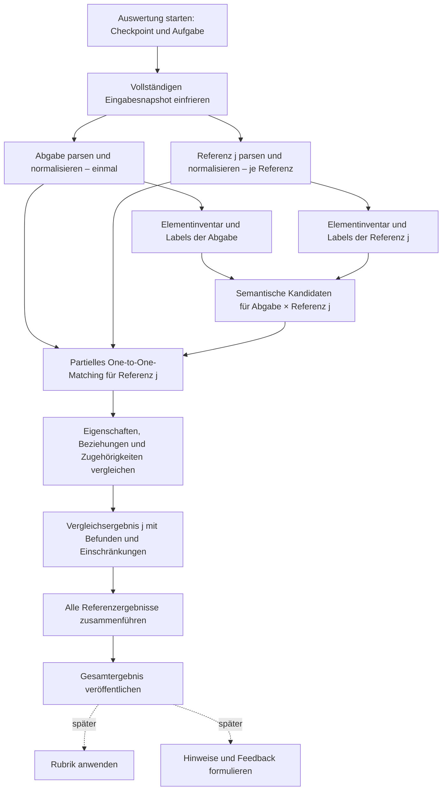

# Konzept für eine durchgängige Modellvergleichs-Pipeline

Die [Arbeitspakete zur schrittweisen Umsetzung](model-comparison-work-packages/README.md) konkretisieren dieses Konzept mit je einem Auftrag pro Verarbeitungsschritt sowie den Paketen für Workflow- und Ergebnisintegration. Sie enthalten Arbeitsziele, Eingaben, Ausgaben und Erfüllungskriterien.

**Präzisierter Implementierungsstand 02–04, ausschließlich statisch durchgesehen:** Eingabesnapshot, Vergleichsgraphen, Textinventare und semantische Kandidaten bleiben separate Artefakte im selben Auswertungsbereich. Folgeergebnisse referenzieren Pfade, Hashes und Element-IDs statt vollständiger Vorgängerinhalte; Diagnosen verbleiben beim verursachenden Schritt, während Vollständigkeitsstatus Eingabeeinschränkungen weiterhin berücksichtigen. Deklarierte Childs werden über ihren Parent aufgelöst. Die technischen Zugehörigkeitskanten verwenden den kompakten Vertrag aus Paket 02. Die folgenden geplanten Matching-/Bewertungsschritte werden damit nicht implementiert; Laufzeitfunktion und neue Ausgabegrößen sind nicht nachgewiesen.

## 1. Ziel, initialer Umfang und Grenzen

**Empfehlung:** Die vorhandene Dagu-Pipeline wird zu einem nachvollziehbaren, partiellen One-to-One-Vergleich erweitert:

**eingefrorene Modelle → einheitliche Vergleichsgraphen → semantische Kandidaten → strukturelle Zuordnung → begründete Befunde pro Referenz → konsolidiertes Ergebnis.**

Das Synonym-Matching entscheidet noch nicht, welche Elemente tatsächlich einander entsprechen. Diese Entscheidung trifft der strukturelle Matcher unter Berücksichtigung konkurrierender Kandidaten, Beziehungen und Zugehörigkeiten. Wo die Evidenz nicht reicht, liefert er ausdrücklich eine ungeklärte Zuordnung.

Die initiale Pipeline liefert:

- Zuordnungen von Elementen und Beziehungen einschließlich ihrer Begründungen.
- Korrekte, abweichende, falsch zugeordnete, fehlende und zusätzliche Bestandteile.
- Ungeklärte Kandidatengruppen und die dadurch eingeschränkten Aussagen.
- Getrennte Vergleiche mit mehreren vollständigen Musterlösungen.
- Originalreferenzen, Verarbeitungsversionen und Vollständigkeitsangaben.
- Eine belastbare Datengrundlage für spätere Hinweise und Bewertungen.

**Noch nicht initial enthalten:** automatische Benotung, ausformulierte didaktische Hinweise, Human-in-the-Loop-Dialoge, allgemeine Erkennung beliebiger fachlich äquivalenter Modellierungen und MMU-Matching.

**Verbindlicher Umfang:** Die Pipeline ist von Beginn an allgemein für jede Aufgabe mit ihren Abgaben und Sample Solutions im vorhandenen Modellformat vorgesehen. Der Parser verwendet die jeweils mitgelieferten Sprachdefinitionen und die gespeicherte Modellstruktur. Es gibt keine Pilotsprache, keine pro Sprache fest einprogrammierten Typzuordnungen und keine sprachspezifische Freitextgrammatik. `comparisonConfig: {}` bleibt für die allgemeine Strukturüberführung ausreichend.

Die allgemeine Strukturverarbeitung behauptet keine universelle fachliche Interpretation: Was nicht ausdrücklich aus Modell und Definitionen hervorgeht, bleibt unverändert erhalten beziehungsweise wird neutral als nicht zuordenbar markiert. Die Wahl einer Sprache allein ist kein Grund, eine Aufgabe oder Sample Solution auszuschließen.

**Aktueller Arbeitsrahmen:** Keine Tests erstellen, erweitern oder ausführen. Auch keine manuellen Beispiel-/Containerläufe, Builds, Benchmarks, Lint- oder Syntaxprüfungen. Die Umsetzung und Korrektur wird zunächst ausschließlich statisch durchgesehen. Spätere allgemeine, aufgabenübergreifende Verifikation erfolgt nur auf gesonderten Auftrag. Konzeptionelle Beispiele sind keine Implementierungsvorlage für eine bestimmte Sprache und kein Auftrag zu ihrer Ausführung.

**Kennzeichnung:** Der folgende Ist-Zustand ist aus Code und Quellen belegt. Der Soll-Zustand ist eine Empfehlung. Zahlenwerte für Matching und Bewertung sind ausdrücklich vorläufige, fachlich abzustimmende Vorschläge.

**Analysestand: 10. November 2026.** Für die zugrunde liegende Analyse wurden ausschließlich Quellen und Dateien gelesen. Es wurden keine Dateien geändert und keine Tests, Builds oder Benchmarks ausgeführt. Die Codeanalyse belegt vorhandene Implementierungslogik, aber keinen erfolgreichen Betrieb der gesamten Pipeline. Dieses Dokument hält das daraus entstandene Konzept fest.

## 2. Anforderungen und belegter Ist-Zustand

### Anforderungsmatrix

Die aktuellen Ticketbeschreibungen wurden zusätzlich über die GitHub-API gelesen. Für alle vier Tickets wurden zum Analysezeitpunkt **null Kommentare** gemeldet.

| Quelle | Anforderung und Verbindlichkeit | Berücksichtigung | Umfang |
|---|---|---|---|
| [#19](https://github.com/thm-mni-ii/modeling-copilot/issues/19) | **Verbindlich:** semantische Kandidaten, konfigurierbarer Threshold, Original-IDs, Untersuchung mehrerer leichtgewichtiger Verfahren | Kandidatenmatrix mit Einzelwerten und dokumentierter Kombination; keine endgültige Zuordnung | Initial |
| #19 | **Verbindliches Untersuchungsziel:** Aufgabenkontext, reale Modelle und typische Varianten berücksichtigen | Globale Konkurrenz im Matcher; fachlicher Referenzdatensatz als Voraussetzung belastbarer Schwellen | Initial |
| #19 | **Vorschläge:** konkrete Wörterbücher, Übersetzung, Embeddings; separate Vorverarbeitung; manuell gelabelter Datensatz | Vorhandenen Hybrid verwenden; Label-Extraktion nach Parser beibehalten; Datensatz empfehlen | Initial beziehungsweise gezielte Verbesserung |
| #19 | **Spätere Erweiterung:** Rückfragen bei Mehrdeutigkeit | Ungeklärte Kandidaten erhalten; kein Dialog | Später |
| [#20](https://github.com/thm-mni-ii/modeling-copilot/issues/20) | **Verbindlich:** gleiche Normalisierung für beide Seiten; Typen, Labels, Attribute, Richtung und IDs erhalten | Versionierter Vergleichsgraph mit Herkunft und Diagnosen | Initial |
| #20 | **Vorschlag/offen:** Container und Attribute vollständig als Graph; Beispielstruktur ausdrücklich unverbindlich | Zugehörigkeiten als Kanten, eigenständig vergleichbare Attribute als Knoten | Initial |
| #20 | **Explizite Abstimmung:** Struktur mit Prof. Siepermann besprechen | Konkrete Entscheidungsvorlage in Abschnitt 11 | Vor fachlicher Freigabe |
| [#21](https://github.com/thm-mni-ii/modeling-copilot/issues/21) | **Verbindlich:** zwei Graphen und Synonymmatrix vergleichen; Elemente und Beziehungen anhand mehrerer Kriterien gegenüberstellen | Partielles globales Assignment, strukturelle Nachbewertung und Befundbildung | Initial |
| #21 | **Offene Methodenentscheidung:** direkter Vergleich, GED oder Kombination; keine fertige Bewertung gefordert | Begründete Wahl eines begrenzten Assignment-Verfahrens | Initial |
| [#22](https://github.com/thm-mni-ii/modeling-copilot/issues/22) | **Forschungsauftrag:** fachlich sinnvolle Teilstrukturen und MMU-Literatur untersuchen; kein konkreter Ergebnisvertrag | Wiederverwendbare Graphen, Kandidaten und Herkunft; spätere Unit-Extraktion | Später |
| Konzeptauftrag | **Verbindlich:** rekursive Zugehörigkeiten, Mehrdeutigkeit, mehrere Referenzen, Workflow-Anbindung und Fehlertrennung | Durchgängiger Bestandteil des Entwurfs | Initial |
| Eigene Ableitung | Kanonische Beziehungsdarstellung, vollständige Elementinventare, Ergebniszuordnung und Reproduzierbarkeit | Schließt konkrete Integrations- und Interpretationslücken | Initial |
| Konzeptauftrag | Grundlage für Hinweise und 0–100 Punkte; Matching-Score ist keine Note | Befundvertrag, Rubrikanschluss und Bewertungsbeispiel | Grundlage initial, Funktion später |

### Tatsächliche Komponenten

| Bereich | Belegter Stand | Konsequenz |
|---|---|---|
| Modelle und Export | `exportModelAsXml` und `exportModelAsJson` speichern maxGraph-XML beziehungsweise eine JSON-Hülle mit XML. Modellpakete enthalten zusätzlich Sprachversionen. Siehe [modelPersistence.ts](../web/src/utils/modelPersistence.ts) und [modelPackage.ts](../web/src/utils/modelPackage.ts). | XML und eingefrorene Sprachdefinitionen sind der richtige Ausgangspunkt; kein neuer Export nötig. |
| Beispieldaten | Die [Order-Management-Musterlösung](../api/src/modeling_api/db/migrations/versions/v00_initial_data/order_management_sample_solution.json) enthält echtes Modell-XML. Sprachdefinitionen und weitere Aufgaben liegen in den Seed-Daten. | Geeignet zur Untersuchung des Formats; kein Nachweis einer repräsentativen Sammlung studentischer Fehler. |
| Auslösung | `startEvaluation` speichert bei Änderungen einen Checkpoint und startet die Auswertung. Siehe [ViewModeling.vue](../web/src/views/ViewModeling.vue). | Bestehenden Einstieg und Versionsbezug erhalten. |
| Eingabesnapshot | `_evaluation_input` friert Aufgabe, Abgabe, alle Musterlösungen und rekursiv referenzierte Sprachversionen ein. `start` verwendet den konfigurierten Workflow und begrenzt die komprimierte Startnutzlast. Siehe [evaluations.py](../api/src/modeling_api/services/evaluations.py). | Gute vorhandene Grundlage für reproduzierbare Auswertungen und mehrere Referenzen. |
| Workflow-Daten | `Workspace.write` veröffentlicht unveränderliche JSON-Artefakte; identische Wiederholungen sind idempotent, abweichende Inhalte am selben Pfad werden zurückgewiesen. Siehe [workflow_io.py](../dagu/workflow-services/workflow_io.py). | Vorhandene Dateien/PVC nutzen; keine neue Austauschplattform. |
| Graph-Parser | `parse_model` verarbeitet XML, Sprachdefinitionen, verschachtelte Elternbeziehungen, Anschlussmetadaten und gerichtete/ungerichtete Verbindungen. Feedbackelemente werden herausgefiltert. Siehe [parser.py](../dagu/workflow-services/graph-parser/src/parser.py). | Echte Implementierung, aber noch kein vollständiger fachlicher Vergleichsvertrag. |
| Parsergrenzen | Unbekannte Typen, offene Enden und Elternzyklen werden erhalten. Es gibt keinen fachlichen Vollständigkeitsstatus. Beziehungen werden abhängig von ihrer Verwendung als Kante oder Knoten ausgegeben. | Diagnosen und eine stabile Vergleichsnormalisierung ergänzen. |
| Label-Extraktion | `run` übernimmt IDs und nichtleere Labels aus dem Graphen, überspringt technische Kanten und liefert `source`. Siehe [model-label-extraction/main.py](../dagu/workflow-services/model-label-extraction/src/main.py). | Wiederverwenden; vollständiges Elementinventar und Textaufbereitung ergänzen. |
| Methodenreferenz für Synonym-Matching | `synonym-matching-louis` enthält eine echte `MatchingEngine`, mehrere Verfahren, Einzelwerte, Kombinationen und Caches. Der Standard kombiniert Stringverfahren und ein multilinguales Embedding. Siehe [service.py](../dagu/workflow-services/synonym-matching-louis/src/synonym_matching/service.py) und [config.py](../dagu/workflow-services/synonym-matching-louis/src/synonym_matching/config.py). | Ausschließlich lesend als Methodenreferenz nutzen. Benötigte Verfahren in den eigenen Service `synonym-matching` übernehmen; den Referenzordner unverändert lassen. Seine Qualität auf realen Abgaben ist durch die vorliegende Analyse nicht nachgewiesen. |
| Synonym-Schnittstelle | Die CLI erwartet zwei Labelmengen und liefert nur `synonymMatrix`; sie nutzt nicht den gemeinsamen Workspace-Vertrag. `match()` rundet die ausgegebenen Werte auf vier Stellen. | Ein schmaler Workflow-Adapter sowie ungerundete maschinenlesbare Evidenz fehlen. |
| Struktureller Vergleich | [one-to-one-graph-matching](../dagu/workflow-services/one-to-one-graph-matching/src/main.py) und [minimal-matching-unit](../dagu/workflow-services/minimal-matching-unit/src/main.py) liefern ausdrücklich `not_implemented`. Auch [synonym-matching](../dagu/workflow-services/synonym-matching/src/main.py) ohne den Zusatz `louis` ist ein Platzhalter. | Fachliches Matching fehlt vollständig. |
| Hauptworkflow | Der [Workflow](../dagu/workflows/model-evaluation-graph-matching.yaml) führt `prepare_input → parse_models → extract_labels → publish_results` aus und setzt `assessmentAvailable: false`. | Keine durchgängige Matching-Pipeline vorhanden. |
| Ergebnisanzeige | Die API liest Status, Unterläufe und Artefakte; die [EvaluationSidebar](../web/src/components/modeling/sidebars/EvaluationSidebar.vue) zeigt Schritte und JSON-Ergebnisse. | Geeigneter Einstieg für Vergleichsergebnisse; fachliche Darstellung und Referenzschutz fehlen. |
| Feedback | Modellversionsbezogene, idempotente Feedbackspeicherung sowie `cellId`-bezogene Overlays existieren. Siehe [feedback.py](../api/src/modeling_api/services/feedback.py) und [Feedback.ts](../web/src/model/Feedback.ts). | Anschlussstellen vorhanden, aber kein belegter Übergang von Matching-Befunden zu Feedback oder Noten. |

Die pauschale Dummy-Beschreibung in `dagu/workflow-services/README.md` entspricht damit nicht mehr allen aktuellen Implementierungen. Für den Ist-Zustand ist der gelesene Code maßgeblich.

### Relevante Spannungen und Quellenlage

1. **„Beliebige Modelle“ benötigen trotzdem Sprachregeln.** Die vorhandenen Sprachdefinitionen beschreiben Darstellung und Syntax. Daraus folgt noch keine vollständige fachliche Bedeutung jedes Elements.
2. **`parentId` und Zugehörigkeitskante dürfen keine konkurrierenden Wahrheiten werden.** Aktuell enthält `parentId` die ursprüngliche XML-Eltern-ID, während `contains` bereits technische Ebenen überspringen kann.
3. **Ein erfolgreich beendeter Job ist noch keine erfolgreiche fachliche Analyse.** Die Platzhalter zeigen dies bereits durch äußeres `status: ok` bei innerem `not_implemented`.
4. **Die Bedeutung mehrerer Musterlösungen ist nicht festgelegt.** Das Backend sammelt sie, interpretiert sie aber noch nicht als Alternativen oder ergänzende Anforderungen.

Die zitierte Übersicht von Kunz und Siepermann war über ihren [Abstract und Publikationsdatensatz](https://aisel.aisnet.org/ecis2025/education/education/7/) zugänglich; der Volltextabruf wurde mit HTTP 403 abgewiesen. Keine nur dort vermuteten Einzelheiten werden deshalb als belegt behandelt.

Gezielt ausgewertete Primärquellen sind insbesondere:

- Jayal und Shepperd: Freie Labels, Synonyme und Schreibvarianten bleiben auch nach Textvorverarbeitung ein wesentliches Bewertungsproblem. Das spricht gegen reine Stringgleichheit und gegen die Vorstellung eines abgeschlossenen Synonymwörterbuchs. [Autorenfassung](https://bura.brunel.ac.uk/bitstream/2438/2441/4/JERIC_v20.pdf)
- Smith, Thomas und Waugh: fachlich definierte MMUs, kontextgestützte Nachzuordnung, getrennte Bewertung und Vergleich gegen vollständige alternative Lösungen. Das liefert relevante Anschlussstellen, aber keine unmittelbar übernehmbare Universalinterpretation. [Autorenfassung](https://oro.open.ac.uk/27379/1/smith-thomas-waugh-diagrams-2010.pdf)

## 3. Gesamtpipeline mit Abhängigkeiten und Parallelisierung



Die Referenzzweige laufen unabhängig und mit begrenzter Parallelität. Der Abgabegraph und sein Labelinventar werden für alle Vergleiche wiederverwendet.

### Parser und Synonym-Matching parallel?

**Für den initialen Umfang wird keine Parallelisierung dieser beiden Schritte empfohlen.**

Rein semantische Verfahren benötigen mindestens IDs und Labels, gegebenenfalls die natürliche Sprache. Diese Angaben könnten zwar unmittelbar aus XML extrahiert werden. Im vorliegenden Projekt entscheidet der Parser aber bereits darüber,

- welche Zellen fachliche Elemente und welche Feedback- oder technische Elemente sind,
- welche Beziehungen als eigenständig adressierbare Elemente erscheinen,
- welche Sprachdefinitionen gelten,
- welche Bestandteile bei einer zusätzlichen Normalisierung entstehen.

Eine zweite XML-Extraktion müsste diese Entscheidungen wiederholen. Besonders neu erzeugte Attributknoten könnten im Graphzweig vorhanden sein, im Synonymzweig aber fehlen.

**Verbindliche Datenabhängigkeit:** Die Labelmengen werden aus genau dem Vergleichsgraphen erzeugt, den der Matcher erhält. Ihre Artefakte tragen dessen Hash. Dadurch stimmen IDs und Elementmengen nachweisbar überein.

Eine gemeinsame vorgelagerte Extraktion wäre technisch möglich, würde aber wesentliche Teile des heutigen Parsers vorziehen. Dafür ist aktuell kein belegter Nutzen erkennbar. Parallelisierung erfolgt stattdessen zwischen Modellen und anschließend zwischen Referenzvergleichen.

### Verantwortungen und Verträge

| Schritt | Eingang → Ausgang | Regeln und Standardverhalten | Fehler und Einschränkungen |
|---|---|---|---|
| Snapshot | Gespeicherte Modellversion, Aufgabenrelease, Referenzen, Sprachen → `EvaluationInput` | Erweitertes Format mit zunächst leerem Konfigurationsobjekt und mitgelieferten Sprachdefinitionen; kein Sprachprofil als Voraussetzung, keine späteren Live-Nachladeentscheidungen | Fehlende Sprachversion oder keine gültige Referenz: Vergleich nicht starten |
| Parser/Normalisierung | Ein Modellsnapshot samt Sprachdefinitionen → `GraphArtifact` | Gleiche Regeln auf beiden Seiten; Quellen erhalten; keine automatische fachliche Reparatur | Unlesbares XML: Modellzweig fehlgeschlagen; interpretierbare Problemstellen bleiben mit Diagnosen erhalten |
| Inventar/Labels | `GraphArtifact` → `ElementInventory` | Alle vergleichbaren Elemente aufführen; fehlende Labels ausdrücklich markieren | Ungültige Graphreferenzen: Vertragsfehler; leere Labels sind kein technischer Fehler |
| Semantik | Zwei Inventare, semantische Konfiguration → `CandidateArtifact` | Einzelverfahren und kombinierte Scores; initial keine verlustbehaftete Kandidatenfilterung | Ausfall eines erforderlichen Verfahrens: technische Einschränkung, kein unbemerkter Ersatz durch null |
| Zuordnung | Zwei Graphen, Kandidaten, Vergleichsprofil → `MappingResult` | Globale partielle 1:1-Zuordnung, begrenzte Kontextnachbewertung, Gleichstände erhalten | Ressourcenlimit oder unzureichende Evidenz: betroffenen Bereich offenlassen |
| Befundbildung | Graphen und Zuordnung → `ReferenceComparison` | Eigenschaften, Anschlüsse und Zugehörigkeiten getrennt prüfen; Abhängigkeiten dokumentieren | Ungeklärte Zuordnungen begrenzen nachgelagerte Befunde |
| Zusammenführung | Alle erwarteten Referenzergebnisse → `ComparisonResult` | Vollständige Alternativen getrennt halten; Auswahl begründen | Fehlende Referenzzweige dürfen nicht unbemerkt als vollständiger Gesamtvergleich erscheinen |
| Spätere Bewertung/Feedback | Befunde, Rubrik, Offenlegungsregeln → Bewertung beziehungsweise Hinweise | Eigene Verantwortungen; keine erneute Identitätsentscheidung | Fehlende Rubrik oder unzureichende Grundlage: keine endgültige Note |

Die Schritte sind fachliche Schnittstellen. Sie benötigen nicht jeweils einen eigenen HTTP-Dienst oder ein neues Deployment. Normalisierung kann im Parserprozess erfolgen, Befundbildung im One-to-One-Service und Zusammenführung als kleiner abschließender Workflow-Schritt.

### Betrieb im vorhandenen Workflow

- **Auslösung:** bestehenden Checkpoint- und API-Ablauf erhalten.
- **Zuordnung:** jedes Artefakt enthält `evaluationId`, Modellquelle beziehungsweise Referenzpaar und Eingabehashes.
- **Status:** technischen Laufstatus und fachliche Vollständigkeit getrennt führen.
- **Wiederholung:** unveränderte erfolgreiche Artefakte wiederverwenden. Geänderte Konfiguration bedeutet einen neuen Lauf beziehungsweise eindeutig neuen Artefaktschlüssel.
- **Teilfehler:** unabhängige Referenzzweige dürfen weiterlaufen. Die Zusammenführung muss auch fehlgeschlagene Zweige berücksichtigen und darf nicht ausschließlich auf den Erfolgsfall zugeschnitten sein.
- **Abschluss:** ein explizit benanntes Gesamtartefakt lesen. Die derzeitige API-Ausweichlogik „letztes strukturiertes Schrittergebnis“ ist für fachliche Ergebnisse zu unspezifisch.
- **Startfehler:** `evaluationId` bereits vor dem externen Start persistieren und als Wiedererkennungsmerkmal verwenden. Die aktuelle Reihenfolge „Dagu starten, anschließend Datenbankeintrag schreiben“ kann bei einem Zwischenfehler einen schwer zuordenbaren Lauf hinterlassen.

**Wiederverwendbarkeit:** Graphen hängen von Modellinhalt, Sprachdefinitionen und allgemeiner Verarbeitungsversion ab; semantische Werte zusätzlich von Textvorverarbeitung und Modellrevisionen; Zuordnungen zusätzlich von den allgemeinen strukturellen Vergleichsregeln. Ein sprachspezifisches Normalisierungsprofil ist nicht erforderlich. Initial genügt Wiederverwendung innerhalb eines Auswertungslaufs und bei dessen Wiederholung. Ein laufübergreifender Cache ist eine spätere Optimierung.

## 4. Graphrepräsentation und Austauschformate

### Empfohlener Graph

Der Vergleichskern verarbeitet einen **typisierten Multigraphen mit expliziten Zugehörigkeits- und Anschlusskanten**.

**Vergleichsbereich (implementiert, ausschließlich statisch durchgesehen):** Der Parser übernimmt ausschließlich den rekursiven Inhalt des von der Plattform definierten Modeling-Layers. Die ersten beiden direkten Kinder der eindeutigen Canvas-Wurzel sind in Exportreihenfolge Modeling- und Feedback-Layer. Canvas-Wurzel und beide technischen Layer sind keine Vergleichselemente und erzeugen keine Zugehörigkeitskanten. Der Feedback-Layer mit sämtlichen Inhalten, sonstige Inhalte außerhalb des Modeling-Layers und Verbindungen zu ausgeschlossenen Bestandteilen einschließlich zugehöriger Beschriftungen bleiben außerhalb des Vergleichs. Tatsächlich fehlende Endpunktzellen bleiben dagegen offene Enden. Bereits ausdrücklich gekennzeichnetes Feedback innerhalb des Modeling-Layers bleibt ebenfalls ausgeschlossen. Fachliche Container und unbekannte Bestandteile innerhalb des Vergleichsbereichs bleiben erhalten. Die Bereichsauswahl erfolgt vor der fachlichen Definitionsauflösung, identisch für Abgabe und Referenz und unabhängig von der Modellierungssprache. `graph.excluded` bleibt leer; ein informativer Hinweis `COMPARISON_SCOPE` ersetzt die reguläre Ausschlussinventarisierung. Reguläre Ausschlüsse machen die Interpretation nicht `partial`; Sprachbeobachtungen betreffen nur übernommene Knoten. Fehlende oder beschädigte Plattformstruktur führt zum technischen Eingabefehler, ein gültiger leerer Modeling-Layer zum leeren Graphen. Der vollständige Eingabesnapshot bleibt erhalten. Statisch erfüllte Kriterien und offene Grenzen, einschließlich fehlender Laufzeitverifikation: [Arbeitspaket 02](model-comparison-work-packages/02-graph-parser.md#nachfolgende-präzisierung-vergleichsbereich-modeling-layer).

Für die Vergleichsrepräsentation werden modellierte Beziehungen **einheitlich als Beziehungsknoten** dargestellt. Ihre Enden werden durch Anschlusskanten repräsentiert. Das heißt: Auch eine einfache, bisher direkt ausgegebene Verbindung erhält dieselbe Form wie eine Verbindung mit Kindern.

Diese Vereinheitlichung ist hier begründet: Der bestehende Parser verwendet Beziehungsknoten bereits für mehrere Fälle. Ohne Vereinheitlichung könnte allein das Hinzufügen eines Beziehungslabels oder eine andere Einbettung die Repräsentationsform ändern.

| Bestandteil | Darstellung |
|---|---|
| Klasse, Aktivität, Entität, fachlicher Container | Knoten mit stabiler ID, Typ, Label und Eigenschaften |
| Fachliches Attribut mit eigener Identität | Eigener Knoten |
| Modellierte Beziehung | Knoten `kind: connection` mit eigenem Typ, Label und fachlicher Richtung |
| Anschluss einer Beziehung | Kante `kind: endpoint`, mit Rolle und gegebenenfalls fachlichem Port |
| Unmittelbare Zugehörigkeit | Kante `kind: contains` vom Container zum Inhalt |
| Technisches Attributfach | Erhaltener Knoten mit expliziter Kennzeichnung als struktureller Bestandteil |
| Rein visuelle Angaben | Ausschließlich Herkunfts-/Darstellungsmetadaten; kein Matching-Kriterium |

Der Graph bleibt damit allgemein traversierbar. Fachliche Beziehungen sind durch ihre Beziehungsknoten und Anschlusskanten eindeutig rekonstruierbar. Technische Anschlusskanten zählen nicht als zusätzliche studentische Beziehungen.

**Gerichtet:** Die Beziehung besitzt geordnete fachliche Endrollen.

**Ungerichtet:** Ein Vertauschen der Enden ist beim Vergleich zulässig, einschließlich des entsprechenden Vertauschens endbezogener Angaben.

**Unbekannte Richtung:** `directed: null` bleibt unbekannt. Daraus wird weder „ungerichtet“ noch eine Richtungsabweichung abgeleitet.

Für den ersten Release wird diese Struktur als V1-Vergleichsvertrag festgelegt. Die Pipeline ist noch nicht produktiv eingesetzt; bestehende Graphdefinitionen und ihre Verbraucher dürfen direkt auf diesen Stand gebracht werden. Ein Versionssprung oder eine parallele Unterstützung früherer Entwicklungsformate ist dafür nicht erforderlich.

### Attribute: Knoten oder Eigenschaft?

Ein Attribut wird ein eigener Knoten, sobald es eigenständig

- zugeordnet,
- als fehlend oder zusätzlich erkannt,
- einem anderen Besitzer zugeordnet,
- kommentiert oder bewertet werden soll.

Ist `Menge` als eigener Modellbestandteil gespeichert, bleibt dieser ein Knoten. Als Eintrag in einem undifferenzierten `attributes`-Array wäre seine globale Wiedererkennung beim falschen Besitzer unnötig erschwert. Das Beispiel begründet jedoch keine sprachspezifische Zerlegung von Labeltexten.

Dagegen bleiben Angaben wie `dataType`, `visibility`, `isPrimaryKey` oder ein eindeutig zugehöriger Kardinalitätswert skalare Eigenschaften des jeweiligen fachlichen Trägers. Dafür ist keine unabhängige Elementidentität erforderlich.

**Wichtig:** Vorhandene strukturierte Bestandteile und Eigenschaften werden anhand ihrer expliziten Darstellung übernommen. Freie Texte bleiben unverändert. Der initiale Parser entwickelt keine Grammatik zur Extraktion von Attributen, Methoden oder anderen fachlichen Aussagen aus Labels. Ein nicht zerlegter Freitext ist allein kein Interpretationsfehler.

### Allgemeiner Kern und mitgelieferte Sprachdefinitionen

| Ebene | Zuständigkeit |
|---|---|
| Allgemeiner Kern | IDs, Graphreferenzen, Kandidaten, partielle Zuordnung, Mehrdeutigkeit, Traversierung, Ergebnisprovenienz |
| Allgemeine Übersetzung des vorhandenen Modellformats | Zellstruktur, native Typen, mitgelieferte Definitionsreferenzen, explizite Anschlussrollen, Zugehörigkeiten und gespeicherte Eigenschaften |
| Fachliche Regeln je Sprache/Aufgabe | Vergleichbare Typen, zulässige Abweichungen, bedeutsame Reihenfolge, erlaubte Alternativformen, Rubrikkriterien |

Der Parser löst die eingefrorenen Sprachdefinitionen allgemein auf. Bekannte Typen benötigen keine zusätzliche Registrierung in einer Mappingliste oder einem besonderen Sprachprofil. Ihre Identität ergibt sich aus Typbezeichner und Sprach-/Definitionsbezug. Ein CSS-Stil, eine Pfeilspitze oder ein Beispielmodell ist keine verlässliche fachliche Typdefinition. Weitergehende aufgabenbezogene Vergleichsregeln gehören zu späteren Verarbeitungsschritten und werden nicht als Parser-Sonderfall implementiert.

Der Parser erhält für Elemente und modellierte Beziehungen die belegbare Modellierungssprache und Sprachversion sowie die konkrete Definition oder deren Kandidaten. Eindeutige Herkunft, Mehrdeutigkeit zwischen Sprachen und fehlende Zuordnung werden getrennt dargestellt. Eine bekannte Sprachherkunft kann auch bei mehrdeutiger Definition erhalten bleiben. Mitgelieferte Definitionen sind nicht automatisch tatsächlich verwendete Sprachen; technische Strukturkanten zählen nicht als weitere Modellierungssprache.

Eine zusätzliche neutrale Beobachtung mehrerer beziehungsweise von einer ausdrücklich geforderten Aufgabensprache abweichender Sprachherkünfte wird als Prüfpunkt zur Disposition gestellt. Ein bekanntes ERD-Element in einem sonst aus SEM-Elementen bestehenden Modell darf erkennbar bleiben, ohne dass der Parser daraus „falsche Modellsprache“ ableitet. Sprachabhängigkeiten können beabsichtigt sein; Zulässigkeit, Feedback und Bewertung benötigen nachgelagerte fachliche Regeln. Dafür wird zunächst kein neuer Pflichtparameter in `comparisonConfig` festgelegt.

`completeness.interpretation` und `diagnostics` bleiben vorgesehen: Sie kennzeichnen konkrete Auflösungs- und Übersetzungslücken. Ein vollständig verstandener Bestandteil einer weiteren Sprache ist allein deshalb kein Interpretationsfehler. Informative Sprachbeobachtungen werden von tatsächlichen Einschränkungen getrennt. Die genaue Umsetzung ist in [Arbeitspaket 02](model-comparison-work-packages/02-graph-parser.md) beschrieben.

Vorhandene Syntaxregeln für Verbindungen, Kardinalitäten und Container können als Regelquelle dienen; sie ersetzen keine Aufgabenrubrik. Siehe [Syntax.ts](../web/src/model/Syntax.ts).

### Identität und Herkunft

Die globale Identität eines ursprünglichen Elements lautet:

`(modelId, versionId, cellId)`

Innerhalb eines modellbezogenen Graphs oder Inventars genügt die lokale Knoten-`id`. In Kandidaten- und Vergleichsartefakten gehört zusätzlich die jeweilige Seite aus `pair` zum Bezug; Artefaktpfade sind innerhalb der `evaluationId` aufzulösen. `contains` wird ohne eigene ID durch Art, Quelle und Ziel identifiziert. Gleiche IDs in unterschiedlichen Modellen stellen **keinen** Zuordnungsbeweis dar.

Erzeugte Elemente erhalten deterministische IDs aus Quellidentität und Transformationsrolle. Ihre Herkunft kann auf mehrere Originalelemente zeigen. Beispiel:

```json
{
  "source": {
    "key": "submission",
    "modelId": "model-s",
    "versionId": "version-s"
  },
  "nodes": [
    {
      "id": "s4",
      "kind": "element",
      "type": "detail-type",
      "label": "Menge",
      "properties": { "dataType": "Integer" },
      "origin": {
        "cellIds": ["s4"],
        "derived": false
      }
    }
  ],
  "edges": [
    {
      "kind": "contains",
      "type": "content",
      "source": "s2",
      "target": "s4",
      "directed": true,
      "label": "",
      "language": null
    }
  ]
}
```

Dies ist ein Ausschnitt: `s2` ist im vollständigen Graphen ebenfalls enthalten. Das Beispiel wird in Abschnitt 6 fortgeführt.

### Invarianten

1. Jede ursprüngliche relevante Einheit innerhalb des Modeling-Layers bleibt erhalten oder besitzt eine dokumentierte Transformation.
2. Regulär ausgeschlossene Plattforminfrastruktur und Inhalte außerhalb des Vergleichsbereichs werden nicht einzeln inventarisiert. Tatsächlich erklärungsbedürftige Ausschlüsse behalten einen Grund; unbekannte Elemente innerhalb des Vergleichsbereichs werden nicht still verworfen.
3. Knoten- und Anschlusskanten-IDs sind innerhalb eines Graphen eindeutig; `contains` wird durch Art, Quelle und Ziel identifiziert. Endpunkte verweisen auf vorhandene Knoten oder ausdrücklich dokumentierte offene Enden.
4. Die Vergleichszugehörigkeit wird aus `contains` abgeleitet. Die ursprüngliche XML-Eltern-ID bleibt im Originalknoten beziehungsweise Snapshot erhalten, ohne zusätzliche Herkunftskopie pro Zugehörigkeitskante.
5. Technische Root-/Layer-Zellen liegen außerhalb des Vergleichsgraphen. Innerhalb des Modeling-Layers bleiben Zwischencontainer erhalten; ausdrücklich strukturelle Rollen ändern daran nichts. Eine andere fachliche Zugehörigkeit darf nicht verschwinden.
6. Gleiche Beziehungen besitzen dieselbe Repräsentationsform, unabhängig von vorhandenen Kindern.
7. Innerhalb des festgelegten Vergleichsbereichs erzeugen Reihenfolge, Layout und XML-Zellreihenfolge keine Unterschiede, sofern die Sprache ihnen keine fachliche Bedeutung gibt. Die Reihenfolge der direkten Canvas-Wurzelkinder bestimmt dagegen gemäß Plattformkonvention den Modeling-Layer.
8. Normalisierung korrigiert keine studentischen Fehler.
9. Deklarierte `children` und `additionalLabels` werden im aufgelösten Parent-Kontext bestimmt. Eigenständige Inhalte bleiben auch bei falscher Platzierung identifizierbar. Verbleibende Mehrdeutigkeit eigenständiger Definitionen erzeugt `AMBIGUOUS_DEFINITION`; nicht auflösbare deklarierte Childs erzeugen `UNRESOLVED_CHILD_DEFINITION` statt einer willkürlichen Typfestlegung.
10. Jeder Nachfolger prüft Schema, verwendete Definitionen und Eingabehashes. Ein sprachspezifisches Profil ist keine Voraussetzung.

### Elementinventar und semantischer Übergang

Das implementierte Inventar erhält die vollständige Menge der semantischen und nicht sicher interpretierten Knoten, speichert pro ID jedoch nur das eigene Ergebnis der Textaufbereitung. Vollständige Originalknoten bleiben im referenzierten Graphen:

```json
{
  "graphHash": "sha256:student-graph",
  "graphPath": "graphs/submission.json",
  "elements": [
    {
      "id": "s1",
      "matchText": "Mitarbeiter",
      "labelStatus": "present",
      "textLanguage": null
    },
    {
      "id": "s4",
      "matchText": "Menge",
      "labelStatus": "present",
      "textLanguage": null
    }
  ]
}
```

Leere Labels fehlen nicht im Inventar. Sie erhalten `labelStatus: missing`; der semantische Zweig liefert dafür keine positive Textevidenz.

Ein `CandidateArtifact` enthält:

- `referenceGraphHash` und `studentGraphHash`;
- die Artefaktpfade und Hashes der separat gespeicherten Elementinventare;
- `synonymMatrix`;
- Methoden, Versionen, Rohwerte und Kombinationsregel;
- `threshold`, `filtered` und Angaben zur methodischen Abdeckung.

So kann der Matcher unterscheiden, ob ein Kandidat schlecht bewertet, ausgefiltert oder überhaupt nicht berechnet wurde.

## 5. Synonym-Matching und strukturelle Zuordnung

### Semantische Kandidaten: Methodenreferenz im eigenen Service einsetzen

**Festlegung:** Der Workflow-Service wird unter `dagu/workflow-services/synonym-matching/` implementiert und an den vorhandenen Workspace-Vertrag angebunden. `synonym-matching-louis` ist eine unveränderte Methodenreferenz. Benötigte Verfahren und unterstützende Codeteile werden in den eigenen Ordner übernommen und dort angepasst; im Referenzordner werden weder Code noch Schemas, Dockerdateien oder sonstige Inhalte verändert. Der eigene Service importiert zur Laufzeit keinen Code aus dem Referenzordner. Er trennt die einzelnen Methoden in nachvollziehbare Module und hält Vorverarbeitung, Kombination, Paarablauf und `main.py` übersichtlich getrennt.

Als Ausgangspunkt dient der dokumentierte Standard der Methodenreferenz:

$$
L = 0{,}5 \cdot \operatorname{Mittel}
(\text{Levenshtein},\text{Jaro-Winkler},\text{Zeichen-Trigramme})
+ 0{,}5 \cdot \text{multilinguales Embedding}
$$

Die bestehende Kombination begrenzt die verwendeten Einzelwerte auf `[0,1]`; ursprüngliche Cosinuswerte können negativ sein. Diese unterschiedlichen Skalen müssen in der Evidenz dokumentiert bleiben.

**Diese Wahl ist ein Ausgangspunkt, kein empirisch abgesicherter Sieger.** Die README beschreibt überwiegend kleine synthetische Untersuchungen. Daraus lässt sich keine zuverlässige Leistung auf realen studentischen Abgaben ableiten.

Konkretes Verhalten:

- **Schreibfehler:** Stringverfahren liefern graduelle Evidenz.
- **Übersetzungen:** zunächst multilinguale Embeddings; keine zusätzliche Übersetzungsinfrastruktur im Standardpfad.
- **Abkürzungen:** nur explizite aufgabenbezogene Aliasregeln als starke Evidenz; sonst ungeklärte Kandidaten zulassen.
- **HTML-Formatierung:** `matchText` kontrolliert aus sichtbarem Text gewinnen; Originallabel unverändert erhalten.
- **Großschreibung, Negation, Zahlen:** keine aggressive Standardnormalisierung, die Bedeutungsunterschiede entfernt.
- **Gleiche Labels:** nicht zusammenfassen und nicht automatisch zuordnen.
- **Fehlendes Label:** `not_applicable` für Textevidenz, nicht „Ähnlichkeit null“.
- **Verfahrensergebnisse:** alle tatsächlich berechneten Einzelwerte erhalten, auch wenn sie nicht in die Kombination eingehen.
- **Modell-/Lexikonausfall:** ausdrücklich melden; keine stille Änderung des Bewertungsmaßstabs.

Für die initial begrenzten Modellgrößen wird **`threshold: null` im internen semantischen Artefakt** empfohlen. Damit bleiben alle berechneten Paare verfügbar. Ein konfigurierter Threshold bleibt für gefilterte Ansichten möglich; die ungefilterte Evidenz bleibt referenzierbar.

Ein Kandidaten-Threshold ist nur eine Ausgabefilterung. Er ist weder eine Zuordnungsentscheidung noch eine Notengrenze.

### Methodenentscheidung für #21

Zwei ernsthaft passende Ansätze sind:

| Ansatz | Eignung für den Einstieg |
|---|---|
| Globales bipartites Assignment mit strukturellen Merkmalen und anschließender Befundbildung | Überschaubar, erklärbar, partielle Zuordnungen und explizite Konkurrenz gut darstellbar |
| Gemeinsame Optimierung über Graph-Edit-Operationen | Verknüpft Knoten- und Kantenentscheidungen stärker, benötigt aber geeignete Editkosten und eine erheblich anspruchsvollere Suche beziehungsweise Approximation |

**Empfehlung:** erster Ansatz.

Das Assignment optimiert eine feste Matrix von Paarwerten unter One-to-One-Bedingungen; dafür ist die ungarische Methode geeignet. Sie löst jedoch nicht automatisch das vollständige strukturelle Graphproblem. [Kuhn](https://onlinelibrary.wiley.com/doi/pdf/10.1002/nav.3800020109)

Exakte GED ist im Allgemeinen NP-schwer. Lineare Zuordnungsapproximationen behandeln Knoten- und Kantenentscheidungen nicht vollständig gemeinsam; diese Grenze muss auch für den empfohlenen Einstieg offen benannt werden. [Bougleux et al.](https://arxiv.org/abs/1512.07494)

### Konkreter initialer Ablauf

**1. Vergleichbare Elemente inventarisieren.**

Alle fachlichen Elemente sind global sichtbar, über sämtliche Container hinweg. Beziehungen werden anschließend mit ihren Endpunkten verglichen.

**2. Paarmerkmale berechnen.**

Ein vorläufiges Profil kann folgende Gewichtung verwenden:

| Merkmal | Gewicht |
|---|---:|
| Semantische Label-Evidenz `L` | 0,55 |
| Typverträglichkeit `T` | 0,10 |
| Vergleichbare Eigenschaften `P` | 0,10 |
| Fachliche Nachbarschaft `N` | 0,20 |
| Containerkontext `C` | 0,05 |

Diese Werte sind eine **abzustimmende Startkonfiguration**. Nicht anwendbare Kriterien werden aus dem Nenner genommen; zusätzlich wird die Evidenzabdeckung ausgegeben. Ein hoher Wert aus einem einzigen schwachen Kriterium genügt nicht.

Nachbarschaft berücksichtigt Beziehungstypen, Richtung, Rollen und später bereits belastbar zugeordnete Nachbarn. Technische Anschlusskanten werden dabei nicht wie eigenständige fachliche Beziehungen gezählt.

**3. Vorläufiges globales Assignment berechnen.**

- Jeder Referenzknoten erhält höchstens einen Abgabeknoten.
- Jeder Abgabeknoten wird höchstens einmal verwendet.
- Beide Seiten besitzen eine echte Nichtzuordnungsoption.
- Unterschiedliche Modellgrößen benötigen keine erzwungenen Paarungen.

Ein möglicher Startwert ist `acceptThreshold: 0.70`. Optimiert wird der positive Zuordnungsnutzen oberhalb dieser Grenze; Nichtzuordnung hat Nutzen null. Zusätzlich gelten Evidenzanforderungen.

**4. Konkurrenz und Gleichstände prüfen.**

Für ein vorgeschlagenes Paar wird untersucht, wie gut die beste alternative Gesamtzuordnung ohne dieses Paar wäre. Ist die Differenz klein — vorläufig etwa `ambiguityMargin: 0.05` — bleibt die betroffene Konkurrenzgruppe ungeklärt.

Eine Sortierung nach ID darf Ergebnisse reproduzierbar darstellen, aber keinen fachlichen Gleichstand entscheiden.

**5. Ein struktureller Nachbewertungsschritt.**

Nur vorläufig stabile, unabhängig ausreichend gestützte Zuordnungen dienen als Kontextanker. Mit ihnen werden Nachbarschaft und Zugehörigkeit erneut bewertet und das globale Assignment einmal neu berechnet.

Dabei dürfen frühere Vorschläge widerrufen werden. Widersprüchliche oder nur zirkulär gestützte Zuordnungen werden nicht endgültig übernommen. Bleibt weitere Iteration nötig, endet der initiale Algorithmus mit einem ungeklärten Bereich.

**6. Beziehungen und Eigenschaften vergleichen.**

Nach der Elementzuordnung werden Beziehungskandidaten über ihre Endpunkte, Typen, Rollen, Labels und Eigenschaften verglichen. Parallelkanten bleiben einzelne Beziehungen und werden ebenfalls höchstens einmal verwendet.

### Reicht eine einmalige semantische Übergabe?

**Ja, als Service-Schnittstelle; nein, als endgültige Entscheidung.**

Der Synonym-Service übergibt einmal die vollständige Evidenz. Der strukturelle Matcher verwendet sie in zwei begrenzten Bewertungsdurchgängen. Dafür muss der semantische Dienst nicht erneut aufgerufen werden.

Eine zusätzliche Rückkopplung an ein Sprachmodell ist initial nicht erforderlich. Sie würde erst dann relevant, wenn neue kontextabhängige Textevidenz berechnet werden soll.

### Harte und weiche Regeln

| Kriterium | Behandlung |
|---|---|
| One-to-One-Verletzung | Hart ausgeschlossen |
| Ungültiger Artefaktbezug oder falscher Eingabehash | Technischer Vertragsfehler |
| Technische Anschlusskante gegen fachliche Klasse | Kein sinnvoller Vergleichspartner |
| Unterschiedlicher Container | Weiches Kriterium; später eigener Befund |
| Unterschiedlicher konkreter Elementtyp | Grundsätzlich weich, damit Typfehler erkennbar bleiben |
| Unterschiedliche Knotengrade | Weich; kann Folge fehlender Beziehungen sein |
| Gleiche Labels | Positive Evidenz, kein Identitätsbeweis |
| Fehlendes Label oder unbekannter Typ | Fehlende Evidenz; kein automatischer Ausschluss |
| Fachlich explizit ausgeschlossene Entsprechung | Hart nur mit dokumentierter Regel |

Ein globales Assignment garantiert nur **höchstens ein Gegenstück**, nicht dessen fachliche Richtigkeit.

Auch nach erfolgreicher Begriffszuordnung bleiben Richtungen, Rollen, Kardinalitäten, Eigentümerschaft, Parallelbeziehungen, symmetrische Teilstrukturen und zulässige alternative Modellierungen zu prüfen. Die Hypothese „danach ist der Graphvergleich einfach“ trifft daher nicht zu.

### Beziehungen und alternative Modellierungen

Bei sicher zugeordneten Endpunkten lassen sich belastbar erkennen:

- fehlende oder zusätzliche Beziehungen;
- falscher Beziehungstyp;
- vertauschte Richtung;
- abweichende Rollen oder Kardinalitäten;
- ein offenes oder falsches Ende.

Eine klar zugehörige, aber falsche Beziehung ergibt einen Abweichungsbefund, nicht automatisch je einen vollen Fehlend- und Zusätzlich-Befund.

Ist ein Endpunkt ungeklärt, bleiben davon abhängige Beziehungsbefunde ebenfalls ungeklärt. Eine Beziehung mit falschem Endpunkt darf nur dann als dieselbe fehlerhafte Beziehung identifiziert werden, wenn weitere Evidenz sie ausreichend eindeutig macht.

Fachlich gleichwertige Umformulierungen werden initial durch **vollständige Referenzalternativen** oder wenige ausdrücklich freigegebene Normalisierungsregeln abgedeckt. Eine Klasse gegen mehrere Klassen oder eine Beziehung gegen einen ganzen Pfad liegt außerhalb allgemeiner One-to-One-Zuordnung.

## 6. Verschachtelungen, Fehlplatzierungen und ungeklärte Zuordnungen

### Globale Identität, lokale Zugehörigkeit

Elementzuordnung und Besitzervergleich sind getrennte Entscheidungen:

1. Global feststellen, welches Element vermutlich gemeint ist.
2. Seine unmittelbare beziehungsweise profilgemäß wirksame Zugehörigkeit vergleichen.
3. Weitere Vorfahrenbeziehungen rekursiv prüfen.

Ein transparenter Attributlisten-Container kann bei der Ermittlung des fachlichen Besitzers übersprungen werden. Die zugrunde liegende Kette bleibt als Evidenz erhalten.

Wird ein ganzer Container verschoben, entsteht zunächst ein Befund an dessen abweichender Zugehörigkeit. Seine Kinder bleiben lokal korrekt zugeordnet, wenn ihre Beziehungen innerhalb des Containers stimmen. Der geänderte Vorfahrenpfad wird nicht für jedes Kind erneut voll bestraft.

Doppelte Namen bleiben getrennte Instanzen. Containerkontext kann ihre Zuordnung unterstützen, darf aber die globale Suche nicht ersetzen.

### Durchgängiges Beispiel

Die folgenden Modelle sind ein **konzeptionelles Beispiel**, keine gemessenen Repository-Ergebnisse. Es darf weder besondere Typzuordnungen noch Textgrammatiken im Parser begründen und wird derzeit nicht ausgeführt. Die Verarbeitung wird allgemein aus den jeweils vorhandenen Modelldaten und Sprachdefinitionen abgeleitet.

Beide Modelle enthalten das Paket `Verkauf`.

| Referenz | Abgabe | Struktur |
|---|---|---|
| `r1: Angestellter` | `s1: Mitarbeiter` | Klasse im Paket |
| `r2: Auftrag` | `s2: Auftrag` | Klasse im Paket |
| `r3: Position` | `s3: Position` | Klasse im Paket |
| `r4: Menge` | `s4: Menge` | Referenz: Attribut von `Position`; Abgabe: Attribut von `Auftrag` |
| `r5: Telefon` | `s5: Kontakt` | Attribut von `Angestellter` beziehungsweise `Mitarbeiter` |
| `r6: E-Mail` | Kein weiteres Attribut | Gleicher Besitzer |
| `r7: bearbeitet` | `s7: bearbeitet` | Verbindung zwischen Beschäftigtem und Auftrag |
| `r8: besteht aus` | `s8: besteht aus` | Verbindung zwischen Auftrag und Position |

Das Modell ist mehrstufig: `Paket → Klasse → Attribut`.

**Semantik:** `Angestellter ↔ Mitarbeiter` ist ein plausibler Synonymkandidat; `Menge ↔ Menge` besitzt starke Textevidenz. Für `Kontakt` bleiben `Telefon` und `E-Mail` ähnlich plausible Kandidaten.

Ein Ausschnitt des semantischen Artefakts könnte so aussehen:

```json
{
  "referenceGraphHash": "sha256:reference-graph",
  "studentGraphHash": "sha256:student-graph",
  "threshold": null,
  "filtered": false,
  "synonymMatrix": [
    {
      "referenceElementId": "r5",
      "matches": [
        {
          "submissionElementId": "s5",
          "scores": {
            "levenshtein": 0.14,
            "jaro_winkler": 0.43,
            "char_trigram": 0.0,
            "multilingual": 0.78
          },
          "combinedScore": 0.485
        }
      ]
    }
  ]
}
```

Die Zahlen illustrieren nur den Vertrag. Das vollständige Artefakt enthält auch `r6` und alle weiteren berechneten Paare. Ein niedriger kombinierter Wert darf den Kandidaten nicht vor der strukturellen Prüfung unwiederbringlich entfernen.

**Struktur:**

- `r1 ↔ s1` wird durch Typ und Verbindung zu den jeweils zugeordneten Aufträgen gestützt.
- `r4 ↔ s4` bleibt global zuordenbar, obwohl der Besitzer abweicht.
- Für `s5` hilft die Struktur nicht: Beide Referenzattribute liegen beim gleichen Besitzer und haben keine unterscheidenden Beziehungen.

**Befunde:**

- Beschäftigtenklasse vorhanden und passend zugeordnet.
- `Menge` vorhanden, aber falsch zugeordnet: tatsächlicher Besitzer `s2`, erwartetes Gegenstück des Referenzbesitzers `s3`.
- `Kontakt` bleibt ungeklärt zwischen `Telefon` und `E-Mail`.
- Die beiden fachlichen Verbindungen können unabhängig davon als passend erkannt werden.
- Unter der vereinbarten One-to-One-Attributdarstellung kann ein einziges `Kontakt` höchstens eines der beiden Referenzattribute abdecken. Es ist aber nicht belastbar feststellbar, welches fehlt.

Gerade der letzte Punkt zeigt den Unterschied zwischen **gesicherter Mengenabweichung** und **ungeklärter Elementidentität**.

### Zustände und Aussagegrenzen

| Zustand | Bedeutung |
|---|---|
| `matched` | Identität ausreichend gestützt; Korrektheit einzelner Aspekte noch separat prüfen |
| `misplaced` | Element zugeordnet, aber fachliche Zugehörigkeit weicht ab |
| `different` | Element/Beziehung zugeordnet, mindestens ein vergleichbarer Aspekt weicht ab |
| `missing` | Referenzelement ohne Gegenstück nach abgeschlossener, ausreichend abgedeckter Kandidatenprüfung |
| `additional` | Abgabeelement entsprechend ohne Referenzgegenstück |
| `unresolved` | Plausible Konkurrenz oder unzureichende Information verhindert eine belastbare Entscheidung |

Die Nichtzuordnung durch den Optimierer allein genügt nicht für `missing` oder `additional`.

Bei ungeklärten Paaren bleiben unabhängige Befunde gültig. Eigentümerschaft, Beziehungen und Eigenschaften, deren Vergleich die offene Identität benötigt, erhalten dagegen `blockedBy`-Verweise. Technisch nicht interpretierte Bereiche sind zusätzlich von semantisch ungeklärten Bereichen zu unterscheiden.

## 7. Umgang mit mehreren Musterlösungen

**Abzustimmende Empfehlung:** Alle Musterlösungen einer Aufgabe gelten initial als **vollständige Alternativen**.

Ergänzende Teilanforderungen wären ein anderer fachlicher Vertrag. Sie gehören in eine explizite Anforderungs- beziehungsweise Rubrikstruktur und dürfen nicht still aus mehreren Modellen zusammengesetzt werden.

Für jede Referenz $R_j$ wird derselbe Abgabegraph unabhängig verglichen. Das Ergebnis behält immer `referenceKey`, Modellversion und Profil.

### Auswahl im initialen Umfang

Die initiale Auswahl verwendet einen **normalisierten strukturellen Abweichungswert**, keine Note.

Dazu erhält jeder fachlich relevante Aspekt ein Vergleichsgewicht. Technische Knoten und erzeugte Anschlusskanten erzeugen keine zusätzlichen fachlichen Gewichte. Ein möglicher Wert ist:

$$
D_j =
\frac{
W_{\text{unmatched reference}}
+ W_{\text{unmatched student}}
+ \sum_{\text{matched aspects}}(w_r+w_s)\,d
}{
W_{\text{reference}}+W_{\text{student}}
}
$$

Dabei beschreibt $d\in[0,1]$ die Abweichung eines vergleichbaren Aspekts. Identität, Besitz und Eigenschaften werden nicht mehrfach über denselben Graphfehler gezählt.

- Kleine und große Referenzen werden damit nicht allein anhand ihrer absoluten Fehlerzahl verglichen.
- Offene Zuordnungen führen zu einem Wertebereich oder einer ausdrücklich eingeschränkten Rangfolge.
- Eine Referenz wird nur bei ausreichend eindeutiger Auswahl maßgeblich.
- Bei überlappenden Unsicherheitsbereichen bleiben mehrere Referenzen im Ergebnis; `selectedReferenceKey` kann leer bleiben.
- Ein ausgefallener Referenzzweig verhindert die Behauptung, die beste aller Alternativen gefunden zu haben.

Diese Normalisierung löst noch nicht jedes Problem unterschiedlicher Modellgranularität. Für die spätere Bewertung müssen alle Alternativen auf **dieselben Lernziele und dasselbe Punktebudget** abgebildet sein.

### Kein künstliches Gesamtmodell

Es wird weder der beste Knoten aus Referenz A mit der besten Beziehung aus Referenz B kombiniert noch der beste Teilpunktestand pro Referenz eingesammelt.

Später darf die Bewertung den besten vollständigen, nach derselben Rubrik bewerteten Alternativvergleich auswählen. Diese Bewertungswahl ersetzt dann ausdrücklich die rein strukturelle Orientierungsauswahl. Beide Auswahlgründe müssen im Ergebnis unterscheidbar sein.

Solange die Referenzauswahl offen ist, werden widersprüchliche referenzspezifische Hinweise nicht als allgemeingültige Fehler ausgegeben.

## 8. Ergebnisvertrag, Feedback und Bewertung

### Vier getrennte Ebenen

1. **Kandidaten:** Welche Entsprechungen kommen infrage?
2. **Zuordnung und Befunde:** Was lässt sich über die Modelle feststellen?
3. **Rubrik:** Welche Leistung folgt daraus?
4. **Feedback:** Wie wird das Ergebnis verständlich und angemessen offengelegt?

Eine spätere Rubrik darf eine fachlich begründete Zuordnung nicht nachträglich verändern, nur um einen besseren Punktestand zu erzeugen.

### Ergebnisvertrag

Der bestehende Workflow-Umschlag wird weiterverwendet. Für den noch geplanten Gesamtabschluss enthält `result` den Vertrag `comparison-result/v1`; Einzelvergleiche bleiben über `referenceResults` referenziert. Gekürztes Planungsbeispiel:

```json
{
  "schema": "comparison-result/v1",
  "evaluationId": "evaluation-1",
  "submission": {
    "modelId": "model-s",
    "versionId": "version-s"
  },
  "referencePolicy": "complete_alternatives",
  "selectedReferenceKey": "reference_1",
  "resultStatus": "partial",
  "completeness": {
    "technical": "complete",
    "interpretation": "complete",
    "mapping": "partial"
  },
  "assessmentAvailable": false,
  "referenceResults": [
    {
      "referenceKey": "reference_1",
      "availability": "available",
      "comparisonPath": "comparisons/reference_1.json"
    }
  ],
  "warnings": [],
  "errors": []
}
```

Der referenzierte Einzelvergleich trägt seine eigenen Zuordnungen und Befunde, beispielsweise:

```json
{
  "schema": "reference-comparison/v1",
  "evaluationId": "evaluation-1",
  "pair": { "studentKey": "submission", "referenceKey": "reference_1" },
  "mapping": [
    {
      "referenceId": "r4",
      "studentId": "s4",
      "status": "matched",
      "evidenceRefs": ["evidence-quantity"]
    }
  ],
  "unresolvedGroups": [
    {
      "id": "u1",
      "referenceIds": ["r5", "r6"],
      "studentIds": ["s5"],
      "reasonCode": "AMBIGUOUS_CORRESPONDENCE",
      "maxMatchedCount": 1
    }
  ],
  "findings": [
    {
      "id": "f1",
      "code": "WRONG_OWNER",
      "status": "supported",
      "referenceIds": ["r4"],
      "studentIds": ["s4"],
      "expectedOwnerReferenceId": "r3",
      "actualOwnerStudentId": "s2",
      "criterion": "attribute.owner",
      "evidenceRefs": ["evidence-owner"],
      "groupId": "quantity-ownership",
      "blockedBy": []
    }
  ]
}
```

Beide Ausschnitte sind gekürzt und nicht implementiert. Gesamt- und Einzelvergleich erhalten zusätzlich die jeweils benötigten eigenen Angaben beziehungsweise Referenzen auf:

- erfolgreiche und fehlgeschlagene Referenzzweige;
- Eingabe-, Graph- und Konfigurationshashes;
- Service-, Profil- und Modellrevisionen;
- Normalisierungsherkunft;
- die separat gespeicherten Kandidatenartefakte;
- Kriterienwerte, Gewichtungen, Schwellen und Entscheidungsgründe;
- überprüfte Aspekte, auch wenn kein Fehler gefunden wurde;
- Abhängigkeiten zwischen Befunden;
- Auswahlmetrik und Auswahlbegründung.

**Scorebedeutung:** `combinedScore`, struktureller Paarwert und `D_j` sind unterschiedliche Größen. Keiner davon wird als Wahrscheinlichkeit, kalibrierte Konfidenz oder Note bezeichnet.

### Rückwärtsprüfung der benötigten Evidenz

| Gewünschte Aussage | Dafür zwingend benötigte Grundlage |
|---|---|
| „Menge ist vorhanden“ | Belastbare globale Elementzuordnung |
| „Menge gehört zum falschen Objekt“ | Zuordnung von Attribut und Besitzern; erhaltene Zugehörigkeitsketten |
| „Die Beziehung zeigt in die falsche Richtung“ | Zugeordnete Endpunkte; bekannte fachliche Richtung und Rollen |
| „Ein Element fehlt“ | Vollständiges Inventar, ausreichende Interpretationsabdeckung und ausgeschlossene offene Kandidaten |
| „Diese Lösung passt zur zweiten Referenz“ | Vollständige getrennte Referenzvergleiche und dokumentierte Auswahlregel |
| „Dafür gibt es Teilpunkte“ | Rubrikkriterium, Maximalgewicht, Teilpunktregel und belegter Befund |
| „Hier ist ein Hinweis am Element“ | Originalmodellversion, Zellreferenz und freigegebene Offenlegungsstufe |

### Feedback

Später werden aus Befundcodes kontrollierte Vorlagen erzeugt. Für das Beispiel:

- `WRONG_OWNER`: „Prüfe, zu welchem fachlichen Objekt das Attribut ‚Menge‘ gehört.“
- `AMBIGUOUS_CORRESPONDENCE`: „Die Bezeichnung ‚Kontakt‘ lässt sich nicht eindeutig einer erwarteten Information zuordnen. Präzisiere, welche Information du modellierst.“
- Positives Feedback: „Die Verbindung zwischen Mitarbeiter und Auftrag ist nachvollziehbar modelliert.“

Die erste Hinweisstufe muss nicht nennen, dass die Musterlösung `Position`, `Telefon` oder `E-Mail` erwartet. Eine genauere Erklärung kann später durch die Aufgabenregel erlaubt werden.

**Konkrete Integrationsanforderung:** Vollständige Referenzgraphen und interne Begründungen dürfen nicht ungefiltert in der studentischen JSON-Anzeige erscheinen. Die API benötigt eine studentische Ergebnisprojektion; vollständige Diagnoseartefakte bleiben einer dafür berechtigten Ansicht vorbehalten.

Overlays werden nur auf die analysierte Modellversion angewendet. Bei einem inzwischen geänderten Canvas muss der Versionsunterschied sichtbar sein.

### Bewertung zwischen 0 und 100

Eine Rubrik definiert pro Kriterium:

- `criterionId`;
- maximales Gewicht;
- erforderliche Evidenz;
- mögliche Teilpunkte;
- Abhängigkeiten;
- zulässige Alternativen;
- Behandlung zusätzlicher Bestandteile;
- Gruppen zur Vermeidung mehrfacher Abzüge.

Für entschiedene Kriterien gilt beispielsweise:

$$
\text{score}
=
100 \cdot
\frac{\sum_k w_k\,a_k}{\sum_k w_k}
\quad\text{mit}\quad a_k\in[0,1].
$$

Ungeklärte Kriterien werden **nicht aus dem Nenner entfernt**. Sonst würde Unsicherheit den Punktestand künstlich erhöhen.

Zusätzliche Elemente erzeugen nicht automatisch Abzüge. Die Rubrik muss festlegen, wann sie fachlich schädlich, redundant oder ausdrücklich erlaubt sind. Etwaige Abzüge sind begrenzt und dürfen nicht zusätzlich denselben bereits erfassten Fehler bestrafen.

### Beispielbewertung

Die folgende Rubrik ist ausschließlich ein **fachlich abzustimmendes Rechenbeispiel**:

| Kriterium | Maximalpunkte | Befund |
|---|---:|---:|
| Paket korrekt | 5 | 5 |
| Drei Klassen jeweils passend vorhanden | 30 | 30 |
| `Menge` als Attribut vorhanden | 10 | 10 |
| `Menge` korrekt zugeordnet | 5 | 0 |
| Zwei fachliche Beziehungen korrekt | 30 | 30 |
| `Telefon` und `E-Mail` jeweils passend vorhanden | 20 | Ungeklärt; höchstens eines durch `Kontakt` abdeckbar |
| **Gesamt** | **100** | **75 gesichert; höchstens 85 unter diesem Vergleichsprofil** |

Das Ergebnis lautet deshalb zunächst:

**`score: null`, vorläufiger Bereich `[75,85]`, Bewertung unvollständig.**

Der Bereich ist kein statistisches Konfidenzintervall. Er folgt aus den offenen Kriterien und der One-to-One-Beschränkung.

`Menge` wird dabei einmal wegen der falschen Zugehörigkeit berücksichtigt. Es entstehen keine zusätzlichen vollen Abzüge für „Menge fehlt“, „Menge zusätzlich“ und zwei abweichende technische Zugehörigkeitskanten.

Die initiale Pipeline berechnet diese Note noch nicht. Sie liefert bereits sämtliche benötigten Zuordnungen, Befunde, Abhängigkeiten und Unsicherheiten.

## 9. Fehlerverhalten, Grenzen und Anschlussstellen für #22

### Fehlerverhalten

| Fall | Reaktion | Fachliche Konsequenz |
|---|---|---|
| Vorhandener leerer Modeling-Layer in gültiger Plattformstruktur | Normal weiterverarbeiten | Erwartete Bestandteile können fehlen; kein technischer Fehler |
| Fehlende oder beschädigte Canvas-/Layerstruktur | Modellzweig mit technischem Eingabefehler abbrechen; kein Fallback auf übrige Zellen | Kein fachlicher Befund aus einem unbestimmten Vergleichsbereich |
| Fehlendes XML, kaputtes XML, doppelte Zell-IDs | Modellzweig abbrechen | Keine fachliche Bewertung dieses Modells |
| Keine Referenz | Gesamtvergleich nicht verfügbar | Kein Punktestand |
| Ungültige Referenz | Betroffenen Zweig sperren, andere untersuchen | Keine unqualifizierte Auswahl der besten Alternative |
| Unbekannter Typ oder nicht unterstützter Inhalt | Erhalten, Diagnose und Interpretationslücke ausgeben | Betroffene Aussagen und Bewertung einschränken |
| Doppelte Labels | Als getrennte Elemente weiterführen | Kontext verwenden oder ungeklärt lassen |
| Offene Verbindung | Originalende erhalten; profilabhängigen lokalen Befund erzeugen | Nur eindeutig belegbare Fehler bewerten |
| Fehlende Parent-Referenz oder Zugehörigkeitszyklus | Erhalten und diagnostizieren; Traversierung begrenzen | Besitzer- und Vorfahrenaussagen im betroffenen Bereich sperren |
| Unterschiedliche Graphgrößen | Partielle Zuordnung mit Nichtzuordnungsoption | Kein Zwangsmatching |
| Semantisches Modell nicht verfügbar | Technischen Methodenausfall melden | Kein stilles Umgewichten mit gleicher Ergebnisbehauptung |
| Ressourcenlimit | Begrenztes beziehungsweise fehlgeschlagenes Ergebnis | Nicht untersuchte Kandidaten nicht als nicht vorhanden behandeln |
| Ein Referenzvergleich fällt aus | Andere Ergebnisse erhalten | Gesamtvollständigkeit eingeschränkt |
| Profil-/Hash-/Quellkonflikt | Betroffenen Übergang abbrechen | Technischer Fehler, niemals studentischer Fehler |

Ein Modellfehler wie eine tatsächlich offene Beziehung kann fachlich relevant sein. Ein Parserfehler, der ihren Anschluss nicht lesen konnte, ist dagegen eine technische Einschränkung. Diese beiden Ursachen müssen getrennte Codes erhalten.

### Grenzen des initialen Matchers

Der Entwurf beansprucht keine vollständige semantische Äquivalenzprüfung:

- Starke Symmetrien können ungeklärt bleiben.
- Unbekannte Synonyme ohne unterscheidenden Kontext können nicht sicher erkannt werden.
- Viele-zu-eins- oder eins-zu-viele-Entsprechungen sind nicht allgemein abgedeckt.
- Tiefer liegende Verhaltensäquivalenz von Prozessmodellen folgt nicht aus ähnlichen Graphen.
- Ein hoher Vergleichswert beweist nicht, dass die Aufgabenstellung vollständig erfüllt ist.
- Zwei strukturelle Durchgänge können schwierige globale Wechselwirkungen ungelöst lassen.

Diese Grenzen sind Gründe für sichtbare Einschränkungen, nicht für scheinpräzise Zuordnungen.

### Prüfung der gemeinsamen Vorarbeit mit #22

**Die Vermutung ist für die technische und semantische Grundlage weitgehend richtig. Für die fachliche Interpretation und Zuordnungslogik gilt sie nur teilweise.**

| Wiederverwendbar | Für MMU zusätzlich oder anders erforderlich |
|---|---|
| Eingabesnapshots und Sprachversionen | Definition, welche Teilstruktur in einer Sprache fachlich eine Einheit bildet |
| Normalisierte Graphen und Originalreferenzen | Extraktion dieser Einheiten einschließlich Rollen und Grenzen |
| Semantische Einzelwerte und Kandidaten | Bewertung von Unit-Kandidaten statt nur einzelner Elemente |
| Zugehörigkeiten, Richtungen und Eigenschaften | Behandlung überlappender Units und gemeinsam verwendeter Knoten |
| Technische Fehler- und Vollständigkeitsangaben | Konsistenzregeln zwischen lokal passenden Units |
| Getrennte Referenzalternativen | Unit-bezogene Rubrik und Schutz vor mehrfacher Punktevergabe |
| Allgemeine Befundprovenienz | Rückverweise einer Unit auf mehrere Originalbestandteile |

Smith et al. definieren MMUs über ihre Bedeutung in der jeweiligen Domäne; sie behandeln außerdem kontextuelle Nachzuordnung und bestimmte bekannte semantische Äquivalenzen. Daraus folgt gerade **keine** sprachunabhängige Regel „jede Kante mit ihren Endpunkten ist immer die richtige fachliche Einheit“. [Smith, Thomas und Waugh](https://oro.open.ac.uk/27379/1/smith-thomas-waugh-diagrams-2010.pdf)

Die notwendige Anschlussstelle ist klein: Ein späterer MMU-Service erhält dieselben Graphartefakte und dieselbe semantische Evidenz und erzeugt Units mit `memberNodeIds`, `memberEdgeIds`, Rollen und Herkunft. Er darf die vorläufige One-to-One-Zuordnung als Hinweis verwenden, sollte aber nicht zwingend von ihr abhängen.

**Teilpunkte benötigen nicht zwingend MMUs.** Bereits der initiale element- und beziehungsbezogene Vergleich kann korrekte Teilbereiche ausweisen. MMUs erweitern vor allem die fachliche Einheit des Vergleichs.

## 10. Priorisierter Umsetzungsplan mit Abhängigkeiten und Abnahmekriterien

Alle folgenden Abnahmekriterien sind konzeptionell. Es wurden dazu keine Prüfungen ausgeführt oder Tests implementiert.

| Priorität / Paket | Konkrete Lücke und vorgesehene Arbeit | Abhängigkeit | Konzeptionelle Abnahme |
|---|---|---|---|
| **P0 – Allgemeinen Eingabeumfang festlegen** | Alle Aufgaben und Sample Solutions im vorhandenen Modellformat mit ihren mitgelieferten Sprachdefinitionen berücksichtigen | Keine | Kein bestimmter Sprachname, Referenzhash oder manuelles Typ-Mapping schaltet die Verarbeitung erst frei |
| **P0 – Vergleichsvertrag festlegen** | Heutigen Graphvertrag um stabile Beziehungsdarstellung, Herkunft, Diagnosen und Vollständigkeit ergänzen | Allgemeiner Eingabeumfang | Layout, XML-Reihenfolge und Kinder einer Beziehung ändern deren fachliche Vergleichsform nicht |
| **P1 – Parsernormalisierung vervollständigen** | `graph-parser` um allgemeine Definitionsauflösung, einheitliche Beziehungen und Erhalt gespeicherter Bestandteile ergänzen | Vergleichsvertrag | Rekursive Zugehörigkeiten, Original-IDs, unbekannte Inhalte und offene Enden bleiben ohne sprachspezifische Grammatik nachvollziehbar |
| **P1 – Labelinventar ergänzen** | `model-label-extraction` um alle vergleichbaren Einheiten, fehlende Labels, `matchText` und Graphhash ergänzen | Vergleichsgraph | Jedes semantisch bearbeitete Element existiert im zugehörigen Graphen; unbeschriftete Elemente verschwinden nicht |
| **P1 – Synonym-Service umsetzen** | Methoden aus der unveränderten Referenz nach `synonym-matching` übernehmen, sinnvoll modularisieren und dort an den Workflow anbinden; vollständige Evidenz publizieren | Inventar und Artefaktvertrag | Referenzordner unverändert; Methoden getrennt; unterschiedliche IDs mit gleichen Labels bleiben getrennt; kein Top-1-Verlust; Methodenausfälle sind sichtbar |
| **P1 – One-to-One-Matching implementieren** | Platzhalter durch globales partielles Assignment mit begrenzter Kontextnachbewertung ersetzen | Graphen und Kandidaten | Kein Element wird doppelt verwendet; falscher Container verhindert keine globale Zuordnung; Gleichstände bleiben offen |
| **P1 – Befundbildung implementieren** | Eigenschaften, Besitzer und Beziehungen vergleichen; Abhängigkeiten und Fehlergruppen erhalten | Zuordnung | Das Beispiel erzeugt `WRONG_OWNER` für `Menge`, eine offene Kontaktgruppe und unabhängige Beziehungsbefunde |
| **P1 – Mehrere Referenzen integrieren** | Paarweise Workflow-Zweige, vollständige Herkunft und konservative Auswahl ergänzen | Paarvergleich | Keine Mischung von Teiltreffern; ausgefallene oder gleich plausible Alternativen bleiben sichtbar |
| **P1 – Laufabschluss absichern** | Explizites Gesamtartefakt, Teilfehlerabschluss, nachvollziehbare Wiederholungen und Startzuordnung | Artefaktverträge | Erfolgreiche Teilresultate bleiben nutzbar; technische Fehler erscheinen nie als fachliche Defizite |
| **P1 – Ergebnis anzeigen und schützen** | API und bestehende Sidebar um fachliche Vollständigkeit und kontrollierte Ergebnisprojektion ergänzen | Ergebnisvertrag | Studierende sehen verständliche Befunde zur richtigen Version, ohne vollständige Referenzdaten offengelegt zu bekommen |
| **Später, gesonderter Auftrag – Allgemeine Qualität verifizieren** | Reale Aufgaben und unterschiedliche Sample Solutions sprachübergreifend berücksichtigen; derzeit keine Datengenerierung oder Testausführung | Allgemeine Implementierung und ausdrücklicher Prüfauftrag | Keine behauptete Laufzeit- oder Matchingqualität ohne entsprechende Nachweise |
| **P2 – Rubrik und Feedback aktivieren** | Befunde auf freigegebene Kriterien und Hinweisvorlagen abbilden; vorhandene Feedbackspeicherung/Overlays anbinden | Fachlich ausreichend belastbare Befunde | Beispielhafte Teilpunkte, Unsicherheitsbereiche und Schutz vor Doppelbestrafung entsprechen der Rubrik |
| **P2 – MMU-Erweiterung** | Sprachbezogene Units, Überlappungsregeln und deren Vergleich erforschen und ergänzen | Gemeinsame Graph- und Kandidatenbasis | Kleine fachliche Einheiten bleiben auf ihre Originalbestandteile zurückführbar; keine mehrfache Punktevergabe |
| **P3 – Optimierungen** | Laufübergreifender Cache und weitere allgemeine Semantikverfahren | Nachgewiesener Bedarf | Verbesserungen sind anhand realer Anforderungen begründet |

Der erste vollständige Lieferumfang endet nach den P1-Paketen: **eine technisch durchgängige, fachlich begrenzte Vergleichspipeline mit nachvollziehbaren Befunden und ausdrücklichen Unsicherheiten.**

## 11. Offene Entscheidungen und notwendige fachliche Abstimmungen

| Entscheidung | Konkrete Empfehlung |
|---|---|
| Allgemeine Sprachunterstützung | Von Beginn an alle mitgelieferten Sprachdefinitionen über denselben Parserablauf verarbeiten; keine Pilotsprache auswählen |
| Graphstruktur aus #20 | Einheitliche Beziehungsknoten, explizite Zugehörigkeiten und eigene Attributknoten mit Prof. Siepermann anhand des Beispiels abstimmen |
| Bedeutung mehrerer Musterlösungen | Vollständige Alternativen; ergänzende Anforderungen ausdrücklich anders modellieren |
| Bedeutung technischer Container | Nur explizit vorhandene Strukturangaben verwenden; unklare Container erhalten statt anhand bestimmter Sprachen zu klassifizieren |
| Zulässige Typabweichungen | Konkrete Fehlertypen vergleichbar lassen; harte Ausschlüsse auf begründete Fälle beschränken |
| Synonyme und Abkürzungen | Kleines aufgabenbezogenes Aliaswissen zulassen; keine Behauptung vollständiger lexikalischer Abdeckung |
| Matching-Schwellen und Gewichte | Vorgeschlagene Werte nur als Startprofil; anhand realer, fachlich annotierter Fälle festlegen |
| Korrekte alternative Modellierungen | Initial durch vollständige Referenzen und wenige benannte Äquivalenzregeln abdecken |
| Bewertung zusätzlicher Bestandteile | Rubrikabhängig, begrenzt und ohne Doppelbestrafung; kein pauschaler Abzug pro zusätzlichem Knoten |
| Umgang mit offenen Bewertungen | Kein endgültiger Punktwert bei entscheidungsrelevanter Unsicherheit; gegebenenfalls begründeten Bereich ausweisen |
| Offenlegung der Musterlösung | Interne Evidenz von studentischen Hinweisen trennen; Stufen in der Aufgabe festlegen |
| Reale fachliche Abnahmebasis | Die in #19 genannten Exporte und Aufgabenbeschreibungen beschaffen; die vorhandenen Seed- und synthetischen Daten reichen dafür allein nicht aus |

Die entscheidende fachliche Freigabe betrifft damit keine neue Plattform, sondern die Bedeutung der Graphbestandteile, zulässige Entsprechungen und den Maßstab, ab wann ein Befund als ausreichend belegt gilt.
