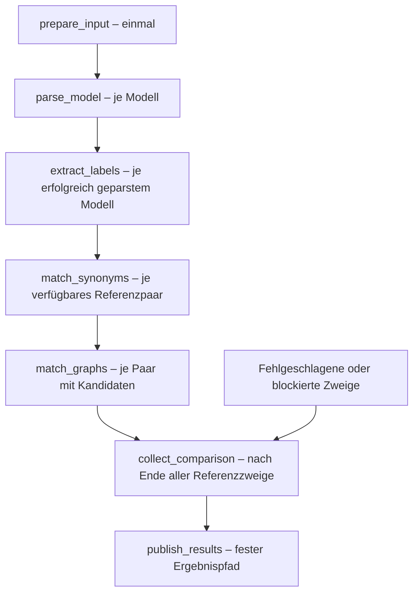

# 07 – Die Verarbeitungsschritte im Dagu-Hauptworkflow verbinden

**Baustein:** Hauptworkflow `model-evaluation-graph-matching` und seine internen Modell-/Paarworkflows.

**Abhängigkeiten:** Verträge und Container aus [01](01-workflow-input.md) bis [06](06-comparison-result.md). Es gelten die [gemeinsamen Verträge](README.md).

**Stand:** Die Ausführung und API-Anbindung bis Phase 4 sind implementiert. Strukturelles Matching, Gesamtabschluss und Teilfehleraggregation aus 05/06 bleiben geplant. Die jüngste Vereinfachung der Artefakte ist nur statisch durchgesehen; vorhandene ältere Läufe belegen diesen Stand nicht.

## Arbeitsziel

Ein Auswertungsstart führt alle notwendigen Verarbeitungsschritte in der richtigen Reihenfolge aus und endet mit einem ausdrücklich benannten Gesamtergebnis. Mehrere Referenzen, einzelne Ausfälle und begrenzte Wiederholungen werden innerhalb der bestehenden Dagu-/Kubernetes-Infrastruktur nachvollziehbar behandelt.

## Ausgangslage und relevante Stellen

- [model-evaluation-graph-matching.yaml](../../dagu/workflows/model-evaluation-graph-matching.yaml): bestehender Hauptworkflow und interne Parser-/Extraktionsworkflows.
- [dagu.py](../../api/src/modeling_api/services/dagu.py): vorhandene Dagu-Anbindung für Start, Status und Artefakte.
- [evaluations.py](../../api/src/modeling_api/services/evaluations.py): Zuordnung der Parser-/Inventarunterläufe pro Modell und Semantikunterläufe pro Referenzpaar.

Der bestehende Hauptworkflow führt `prepare_input`, Parser, Inventare und semantische Kandidaten aus. `publish_results` liefert aktuell `evaluation-preview/v1`, `completedPhase: 4` und die Artefaktpfade, bei `assessmentAvailable: false`. Der weitere geplante Umfang ergänzt Paarvergleich und fachlichen Gesamtabschluss. Er verändert keine Matchingregeln. Die folgende Gesamtergebnisbeschreibung und das Ablaufdiagramm sind das noch nicht vollständig implementierte Ziel.

## Was kommt hinein?

Die API liefert die vorhandenen skalaren Laufparameter mit dem vollständigen Eingabesnapshot, der Modellliste und den Anzahlen. Die Modellliste muss zum Snapshot passen; die Referenzliste wird aus dessen Quellen abgeleitet. Die Container erhalten nur ihre Lauf-/Modellschlüssel und die erforderlichen Artefaktpfade.

Die versionierten Containerimages und die gemeinsam benötigten Modellressourcen sind für die vorhandene Laufzeitumgebung verfügbar. Das Paket umfasst ihre konsistente Referenzierung im Workflow, nicht eine ungefragte produktive Bereitstellung.

## Was kommt heraus?

| Ausgabe | Bedeutung |
|---|---|
| Zugeordneter Dagu-Lauf | Verbindung zwischen `evaluationId` und `dagRunId` |
| Modellbezogene Schritte | Parser- und Inventarstatus je Modell |
| Paarbezogene Schritte | Semantik- und Matchingstatus je Referenz |
| Erfolgreiche Artefakte | Die in der Übersicht festgelegten Pfade |
| Abschlussausgabe | `evaluationId`, `resultPath: results/comparison.json`, fachlicher `resultStatus`, `assessmentAvailable: false` |
| Technischer Laufstatus | Erfolg, Fehler oder Abbruch unabhängig von der fachlichen Korrektheit des Modells |

Die geplante Abschlussausgabe ist ein Manifest. Das eigentliche Gesamtergebnis wird über das benannte Artefakt geladen. Der letzte beliebige JSON-Logeintrag ist kein Ersatz dafür. Im aktuellen Phase-4-Stand werden die getrennten Parser-, Inventar- und Kandidatenartefakte pro Unterlauf geladen; kein Schrittergebnis bettet die vollständigen Ergebnisse seiner Vorgänger ein.

## Geplanter Ablauf

Das Diagramm zeigt die fachlichen Abhängigkeiten. Jeder Paarlauf benötigt die Abgabe und seine eigene Referenz. Ein ausgefallener Referenzzweig blockiert nur sich selbst. Ein ausgefallener Abgabeparser blockiert alle Paarvergleiche; bei vorhandenem gültigem Snapshot kann der Abschluss trotzdem `unavailable` liefern.

## Geplanter Arbeitsumfang

1. **Bestehende Modellschritte erhalten und anpassen.** `graph-parser-model` und `model-label-extraction-model` verwenden die neuen Verträge. Ein Modell wird nur einmal geparst und inventarisiert, unabhängig von der Zahl der Referenzen.
2. **Paarworkflows vervollständigen.** Den vorhandenen `synonym-matching-pair` erhalten und `one-to-one-graph-matching-pair` ergänzen. Beide verwenden `EVALUATION_ID` und `REFERENCE_KEY` sowie die festgelegten Artefaktpfade. Die Abgabe wird nicht pro Referenz erneut vorbereitet.
3. **Abhängigkeiten korrekt ausdrücken.** Extraktion benötigt den eigenen Graphen; Semantik beide Inventare; Matching beide Graphen und das eigene Kandidatenartefakt. Parser und semantisches Matching werden nicht gegen diese Abhängigkeiten parallelisiert.
4. **Parallelität begrenzen.** Unabhängige Modelle und Referenzpaare dürfen parallel laufen. Die bestehende Begrenzung von vier Modellläufen ist eine Ausgangsbasis; die speicherintensive Semantik erhält eine eigene an der Umgebung festgelegte Begrenzung. Es gibt keine zusätzliche Optimierungs-/Benchmarkphase als Voraussetzung.
5. **Teilabbrüche abschließen.** Die Dagu-Abschlussbedingungen so konfigurieren, dass `collect_comparison` nach allen terminalen Referenzzweigen auch bei einzelnen Fehlern startet. Abhängige, nicht ausführbare Schritte als blockiert/übersprungen markieren. Fehlende Artefakte nicht durch Demoausgaben ersetzen.
6. **Ausführungsbedingungen konkret verifizieren.** Die dafür tatsächlich unterstützten Dagu-Abhängigkeiten und Abschlussmechanismen der vorhandenen Version verwenden. Die Umsetzung muss den Teilfehlerabschluss belegen; eine nur syntaktisch plausible YAML-Konfiguration genügt nicht.
7. **Status nach Quelle zuordnen.** Unterläufe besitzen eindeutige Modell- beziehungsweise Paarschlüssel. API und Anzeige ordnen sie über diese Bezüge zu, nicht über ihre zufällige Listenposition. Benötigte Artefakte sind als Dagu-Artefakte abrufbar und nicht nur auf dem PVC bekannt.
8. **Gesamtergebnis veröffentlichen.** `publish_results` verweist ausschließlich auf das geprüfte `results/comparison.json`. Ein fachlich partielles Ergebnis bleibt partiell, auch wenn die Abschlussjobs technisch erfolgreich waren.
9. **Dokumentation und Imagebezüge nachziehen.** Die konkreten Container-/Capability-Beschreibungen und der Workflow müssen dieselben Versionen und Schnittstellen nennen. Keine Änderung weiterer Beispielworkflows ohne sachlichen Bezug.

## Wiederholungen und Abbrüche

| Situation | Vorgesehenes Verhalten |
|---|---|
| Vorübergehender technischer Fehler vor Abschluss | Höchstens ein zusätzlicher Versuch des betroffenen Schritts; gleiche Eingaben und Artefaktpfade |
| Ungültiger Vertrag, XML-Fehler oder falsche Konfiguration | Keine unveränderte Wiederholung |
| Erfolgreiches Artefakt vorhanden | Inhalt und Eingabebezug prüfen; nicht unnötig neu berechnen |
| Abweichender Inhalt am bestehenden Pfad | Konflikt melden, nicht überschreiben |
| Benutzer bricht gesamten Lauf ab | Keine automatische Wiederaufnahme; vorhandene Zwischenergebnisse bleiben erhalten |
| Gesamtergebnis bereits veröffentlicht | Eine neue Auswertung bekommt eine neue `evaluationId` |
| Abschlusscontainer scheitert | Technischer Abschlussfehler; kein beliebiges Zwischenergebnis als Endergebnis |

Bei explizitem Abbruch des gesamten Dagu-Laufs kann der Abschluss selbst ausfallen. Dann zeigt die API den Abbruch und vorhandene Teilschritte mit `finalResult: null`. Ein garantiertes Gesamtergebnis trotz manueller Prozessbeendigung wird nicht behauptet.

Die Aufbewahrung der Workflow-Artefakte folgt der vorhandenen Betriebsumgebung. Paket 08 übernimmt das abgeschlossene fachliche Ergebnis in den Auswertungsdatensatz, damit die historische Anzeige nicht vom dauerhaften Vorhandensein der Logs abhängt.

## Erfüllungskriterien

- [ ] Ein Start verarbeitet die Abgabe einmal und jede Referenz genau einmal pro notwendigem Modell-/Paarschritt.
- [ ] Jeder Schritt erhält ausschließlich die zu seinem Vertrag passenden Artefakte und Quellen.
- [ ] Modell- und Paarunterläufe sind in Dagu und API eindeutig zuordenbar.
- [ ] Eine fehlerhafte Referenz verhindert nicht die unabhängigen Vergleiche anderer Referenzen.
- [ ] Nach einem einzelnen Zweigfehler entsteht ein ausdrücklicher Teilabschluss mit vollständiger erwarteter Referenzliste.
- [ ] Wiederholungen sind begrenzt und erzeugen weder überschreibende Ergebnisse noch zusätzliche unzugeordnete Auswertungen.
- [ ] Der Lauf veröffentlicht einen festen Ergebnispfad; technischer Erfolg wird nicht mit fachlicher Vollständigkeit verwechselt.

**Aktuelle Verifikation:** Ausschließlich statische Durchsicht der Änderungen und Schnittstellen. Keine Tests erstellen, erweitern oder ausführen; keine manuellen Modell-/Containerläufe, Builds, Benchmarks, Lint- oder Syntaxprüfungen. Die Kriterien beschreiben Sollverhalten und sind derzeit kein Auftrag zur Ausführung.

**Übergabe:** [08 – Ergebnisintegration](08-result-integration.md) erhält den zugeordneten Lauf, die Schritte und das eindeutig benannte Gesamtartefakt.
