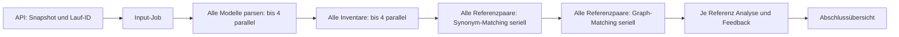
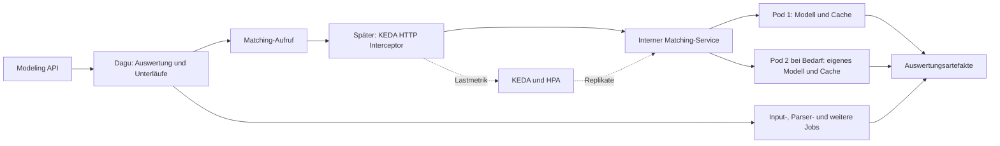

# Konzept: Effizienter Betrieb der Dagu-Workflow-Services

Stand: 13.11.2026. Konzept auf Grundlage des aktuellen Arbeitsstands einschließlich
der vorhandenen, noch nicht committeten Analytical-Feedback-Erweiterung.
Es wurden keine Laufzeitkonfigurationen oder Dienste umgestellt.

## Empfehlung

Den Synonym-Matcher als langlebigen, internen HTTP-Dienst betreiben. Pro
Dienstprozess bleiben das Embedding-Modell und ein begrenzter Text-Embedding-Cache
geladen. Dagu behält die Auswertung, ihre Abhängigkeiten und die Ergebnisartefakte;
Kubernetes betreibt und ersetzt die Dienstinstanzen.

Zunächst mit einer warmen Instanz beginnen. Danach auf dieselbe Dienstschnittstelle
bedarfsgesteuerte Skalierung mit KEDA und dessen HTTP Add-on aufsetzen:
Anfrage weckt den Dienst, weitere Anfragen nutzen warme Prozesse, anhaltender
Bedarf erzeugt zusätzliche Replikate, nach beispielsweise zehn Minuten Leerlauf
wird auf null skaliert. Diese Zeit ist ein zu überprüfender Startwert.

Die übrigen Schritte vorerst als Jobs belassen. Ihre Umstellung lohnt sich erst,
wenn Messungen zeigen, dass Prozess- und Pod-Starts gegenüber der eigentlichen
Arbeit dominieren. Der größte erkennbare Wiederverwendungsnutzen liegt aktuell
beim Synonym-Matching.

## 1. Aktuelle Initialisierung und Aufrufkette

### Infrastrukturstart

- Lokal startet Compose Dagu mit `dagu start-all` und Image
  `ghcr.io/dagucloud/dagu:2.16.6`. Workflow-Dateien und Basiskonfiguration werden
  aus dem Checkout eingebunden. Die Compose-Einträge im Profil
  `workflow-services` definieren vor allem die lokal baubaren Job-Images;
  sie bilden keinen Pool wartender Matching-Dienste.
- In Produktion startet ein Kubernetes Deployment eine Dagu-Instanz. Ein
  Init-Container klont beim Pod-Start den Branch `main` in ein `emptyDir`.
  Dagu liest daraus Workflows und `base.yaml`; spätere Git-Änderungen werden
  während dieses Pod-Lebens nicht laufend synchronisiert.
- Dagu darf im Namespace `workflow-runtime` Jobs anlegen und deren Pods und
  Logs beobachten. Das Manifest definiert dort bisher keinen HTTP-Service
  und kein Deployment für den Synonym-Matcher.
- Das gemeinsame `workflow-data`-PVC hat 5 GiB und `ReadWriteOnce`.

Quellen: [Compose](../docker-compose.yaml),
[Basiskonfiguration](../dagu/infra/base.yaml),
[Produktionsmanifest](../dagu/infra/prod/k3s-dagu.yaml).
Die README weicht teilweise vom Manifest ab: Sie nennt noch einen Feature-Branch;
maßgeblich für diese Analyse ist `--branch=main` im Manifest.

### Eine Auswertung

1. `evaluations.start()` prüft Abgabe, Aufgabe und freigegebene Musterlösungen.
   Es friert Modelle, Sprachdefinitionen und Konfiguration in einem vollständigen
   Snapshot ein und speichert die Auswertungsidentität in MongoDB.
2. Der Snapshot wird als gzip/Base64-Parameter an Dagu übergeben.
   `dagu.start_workflow()` ruft `POST /api/v1/dags/{name}/start` auf;
   `dagRunId` und Auswertungs-ID sind identisch. Der HTTP-Aufruf startet den
   Workflow und wartet nicht auf das gesamte Matching.
3. `prepare_input` startet einen `workflow-data`-Job, der den Snapshot auf
   dem gemeinsamen PVC veröffentlicht.
4. Für Abgabe und jede Musterlösung wird jeweils ein Parser-Unterlauf mit
   eigenem Kubernetes Job gestartet; höchstens vier gleichzeitig pro Fan-out.
5. Nach Abschluss **aller** Parserläufe folgen die Inventar-Jobs, ebenfalls
   mit höchstens vier gleichzeitigen Unterläufen pro Fan-out.
6. Nach **allen** Inventaren folgt pro Musterlösung ein Synonym-Matching-Job.
   Die Referenzen werden in diesem Fan-out nacheinander verarbeitet.
7. Nach **allen** Synonym-Matchings folgen nacheinander die Graph-Matching-Jobs
   je Musterlösung.
8. Nach **allen** Graph-Matchings folgen je Referenz ein Analytical-Feedback-Job
   und anschließend ein separater Feedback-Generation-Job im selben Unterlauf.
9. Dagu veröffentlicht die Abschlussübersicht. Die API liest Laufzustände,
   Unterläufe und Ergebnisartefakte aus Dagu für die Oberfläche.

Bei `R` Musterlösungen entstehen im erfolgreichen aktuellen Hauptworkflow
`1 + 2 × (R + 1) + 4 × R = 3 + 6R` Kubernetes Jobs, ohne Wiederholungen.
Bei fünf Musterlösungen sind das 33 Jobs, darunter fünf separate
Synonym-Matching-Prozesse. Die Abgabe wird einmal geparst und inventarisiert;
es gibt keinen Synonym-Container pro Graphpfad oder pro einzelnem Labelpaar.

Quellen: [API-Lebenszyklus](../api/src/modeling_api/services/evaluations.py),
[Dagu-Adapter](../api/src/modeling_api/services/dagu.py),
[Hauptworkflow](../dagu/workflows/model-evaluation-graph-matching.yaml),
[Analyse-Unterlauf](../dagu/workflows/model-evaluation-graph-matching.yaml).

### Was beim Synonym-Matching wiederholt wird

Das Image wird **nicht bei jedem Auftrag gebaut**. Der
[Dockerfile](../dagu/workflow-services/synonym-matching/Dockerfile) lädt die
festgelegten Modelldateien schon beim Build; Laufzeit-Downloads sind deaktiviert.
`IfNotPresent` erlaubt zusätzlich die Wiederverwendung des lokalen Node-Images.

Jeder `k8s.run`-Schritt startet aber einen neuen Job und Prozess:
Python-/Bibliotheksstart, Laden und Initialisieren des SentenceTransformer-Modells
in den RAM sowie Berechnung der benötigten Embeddings fallen erneut an.
Das Modell wird nur geladen, wenn tatsächlich passende Texte mit der
`multilingual`-Methode verarbeitet werden; leere Vergleiche können es vermeiden.

Auch ein dauerhaft laufender HTTP-Wrapper würde allein noch nicht genügen:
[`compare_pair()`](../dagu/workflow-services/synonym-matching/src/synonym_matching/service.py)
legt `method_states = {}` bei jedem Aufruf neu an.
[`MultilingualMethod`](../dagu/workflow-services/synonym-matching/src/synonym_matching/methods/multilingual.py)
hält Modell und Embeddings nur in dieser Methodeninstanz.
Der bisherige Cache hilft innerhalb eines Paarvergleichs, nicht zwischen Paaren
oder Auswertungen. Beim Vergleich derselben Abgabe mit mehreren Musterlösungen
werden deren Beschriftungen deshalb wiederholt eingebettet.

## 2. Möglichkeiten und Grenzen von Dagu

| Möglichkeit | Bedeutung für dieses Projekt |
| --- | --- |
| `dag.run` und `parallel.max_concurrent` | Abhängigkeiten und begrenzte parallele Unterläufe; keine Warmhaltung von Modellprozessen. |
| `k8s.run` | Startet einen Kubernetes Job. `cleanup_policy: keep` behält das Jobobjekt; ein beendeter Python-Prozess wird dadurch nicht wieder nutzbar. |
| `http.request` | Dagu kann einen bereits betriebenen Matching-Dienst direkt aufrufen und dessen Antwort weiterverarbeiten. |
| Benannte Queues | Begrenzen gleichzeitig ausgeführte, über die Queue abgewickelte DAG-Läufe. Sie sind keine Dienst-Autoskalierung. |
| Distributed Workers | Verteilen DAG-Ausführung auf dauerhafte Worker. Ein dort erneut gestartetes Python-Programm teilt dadurch noch kein geladenes Modell. |
| Docker-Container/Exec-Modus | Kann vorhandene Docker-Container verwenden; passt nicht unmittelbar zum aktuellen Kubernetes-Job-Betrieb und erhält bei neuem Python-Aufruf ebenfalls keinen Modellzustand. |
| Service-DAGs in der aktuellen Online-Dokumentation | `restart_policy` lässt den Scheduler einen DAG dauerhaft betreiben. Das ist Prozessaufsicht, kein anfrageabhängiger Replikat-Pool mit Leerlaufabschaltung. Die Verfügbarkeit in 2.16.6 wurde hier nicht verifiziert. |

`http.request` und die lokale Reichweite von `parallel.max_concurrent` wurden
zusätzlich in den durch Context7 aufgelösten Dokumenten für **v2.16.6** geprüft.
Die übrigen Detailoptionen beschreibt die laufend aktualisierte offizielle
Dokumentation; konkrete Konfigurationen vor Umsetzung gegen 2.16.6 validieren.
Für den Vorschlag ist kein vorsorgliches Dagu-Upgrade erforderlich.

Quellen: [Kubernetes-Aktion](https://docs.dagu.sh/step-types/kubernetes),
[HTTP-Aktion](https://docs.dagu.sh/step-types/http),
[Queues](https://docs.dagu.sh/server-admin/queues),
[Workers](https://docs.dagu.sh/server-admin/distributed/workers/),
[Container-Modi](https://docs.dagu.sh/writing-workflows/container),
[Service-DAGs](https://docs.dagu.sh/writing-workflows/services).

Wichtig für Lastgrenzen: `max_concurrent: 1` gilt für die betreffende
Fan-out-Ausführung. Daraus folgt keine belastbare Obergrenze für alle gleichzeitig
eingehenden Auswertungen. Der aktuelle Adapter verwendet `/start`, die Kinder
`dag.run`; eine ergänzte Queue darf nicht ohne Prüfung dieser Startpfade als
globale Zulassungssteuerung betrachtet werden. `dag.enqueue` bestätigt zunächst
nur das Einreihen. Abhängige Schritte dürfen anschließend erst nach geprüftem
Abschluss weiterlaufen. Eltern und wartende Kinder nicht in dieselbe knappe
Queue stecken, wenn die Eltern deren gesamte Kapazität belegen könnten.

## 3. Zielbetrieb: Dagu orchestriert einen wiederverwendbaren Dienst

Ohne Autoskalierung führt der Matching-Aufruf zunächst direkt zum internen
Service. Nach Aktivierung des HTTP Add-ons muss dieser Verkehr durch den
Interceptor laufen, damit auch bei null Matcher-Pods eine erreichbare Adresse
und ein Aufwecksignal vorhanden sind. Ein nackter Kubernetes Service mit null
Endpoints kann die erste Anfrage nicht selbst aufbewahren.

### Dienstvertrag und Prozesszustand

- Ein Aufruf verarbeitet weiterhin genau eine Abgabe-/Referenzkombination.
  Übergeben werden Auswertungs-ID, Referenzschlüssel, erwartete Input-/Konfigurations-
  und Implementierungsidentität sowie eine stabile Auftragskennung.
- Für die erste Stufe liest der Dienst die bisherigen Inventare und den Snapshot
  vom vorhandenen PVC und veröffentlicht `candidates/<referenceKey>.json`.
  Das vollständige `workflow-result/v1` bleibt die fachliche Antwort.
  Ein zentraler Embedding-Dienst für sämtliche Verfahren ist zunächst unnötig.
- Das gepinnte Modell wird einmal beim Prozessstart geladen, geprüft und mit
  einer kleinen Inferenz aufgewärmt. Eine Startup-Probe berücksichtigt diese Zeit;
  Readiness wird erst danach freigegeben. Die Liveness-Prüfung benötigt keine Inferenz.
- Genau ein Modellprozess pro Pod als Ausgangspunkt. Mehrere Server-Worker würden
  Modell und Cache je Prozess duplizieren. Zunächst eine aktive Berechnung pro
  Pod; begrenzte wartende Anfragen und eine explizite Überlastantwort verhindern
  unbegrenztes Anwachsen. Verteilung und Warteverhalten unter Last prüfen:
  HTTP-Load-Balancing garantiert allein keine gleichmäßige Belegung freier Slots.
- Workspace, IDs, Konfiguration, Ergebnis und Diagnosen bleiben anfragebezogen.
  Die heutigen `WORKFLOW_*`-Umgebungsvariablen dürfen bei parallelen Anfragen
  nicht pro Auftrag global umgeschrieben werden. Den Workspace explizit übergeben.
- Modell und Cache dürfen länger leben; der Methodenstatus und die Provenienz
  eines Ergebnisses müssen trotzdem die tatsächlich in dieser Anfrage verwendeten
  Ressourcen beschreiben. Insbesondere darf ein früher geladenes Modell nicht
  automatisch als für einen späteren leeren Vergleich „verwendet“ gelten.

### Ergebnisübergabe erhalten

Die vorhandene API erwartet `match_synonyms`, den Unterlauf und
`candidates-result.json`. Diese Namen und das Ergebnisformat in der ersten
Umstellung erhalten. Ein HTTP-Erfolg darf erst nach vollständig veröffentlichter
Ausgabe zurückgegeben werden; `202 Accepted` allein wäre noch kein fertiges Ergebnis.

Ein Wechsel von `k8s.run` zu `http.request` muss die Antwort **explizit** in das
bisherige Artefaktformat überführen. Die HTTP-Aktion kann Status, Header und Body
einrahmen; ein solcher HTTP-Umschlag darf nicht versehentlich als
`workflow-result/v1` gespeichert werden. Antwortformat und Extraktion auf 2.16.6
mit einem vorhandenen gültigen Ergebnis prüfen. Dagu benötigt dafür keinen
zusätzlichen PVC-Mount, solange der Matching-Dienst selbst liest und schreibt.

### Cache-Nutzung

1. Pro Prozess ein begrenzter LRU-Cache für Text-Embeddings. Schlüssel umfassen
   den tatsächlich eingebetteten normalisierten Text, Modellrevision sowie alle
   für Vektoren relevanten Encoder-/Vorverarbeitungsparameter. Einträge und RAM
   begrenzen; kein unbegrenztes `dict` über den gesamten Produktionsbetrieb.
2. Gleiche Abgabe- und Referenztexte profitieren über Paar- und Laufgrenzen hinweg.
   Trefferquote messen; jeder Pod hat zunächst seinen eigenen Cache.
3. Einen persistenten oder geteilten Vektorcache erst ergänzen, wenn Messungen
   Wiederberechnung nach Scale-to-zero oder über Replikate als relevant ausweisen.
   Es wird dafür zunächst kein Redis oder zusätzlicher Broker benötigt.
4. Später können auch Parsergebnisse und Inventare unveränderlicher Musterlösungen
   wiederverwendet werden. Schlüssel benötigen Modellinhalt, Sprachabhängigkeiten
   und Produzentenversion. Bestehende Artefakte enthalten auswertungsspezifische
   Identitäten: Sie dürfen nicht unverändert in eine andere Auswertung kopiert werden.

Cache-Treffer dürfen keine fachlichen Kandidaten, Diagnosen oder Vollständigkeits-
angaben ändern. Numerische Effekte anderer Batch-Zusammensetzungen beachten;
ein identischer Modellname allein garantiert keine byteidentische Neuberechnung.

## 4. Warmhaltung, Leerlauf und zweite Instanz

| Zustand | Vorgesehenes Verhalten |
| --- | --- |
| Kein Matcher-Pod | Interceptor nimmt die Anfrage an; KEDA aktiviert mindestens eine Replik. |
| Pod startet | Modell laden und aufwärmen; Anfrage wartet begrenzt bis Readiness. |
| Pod bereit | Matching durchführen, Artefakt veröffentlichen, Antwort liefern. |
| Weitere Anfrage | Warmes Modell und vorhandene Embeddings wiederverwenden. |
| Nachfrage über Kapazität | Replikatzahl bis zur konfigurierten Obergrenze erhöhen; jede neue Replik wärmt ihr eigenes Modell auf. |
| Kurze Pause | Prozesse und RAM-Cache bleiben verfügbar. |
| Längerer Leerlauf | Nach Ablauf der konfigurierten Abklingzeit auf null skalieren. |

Scale-to-zero beendet Pods und gibt deren Speicher frei. Es ist kein
Einfrieren eines Containers mit konserviertem RAM. Die nächste Aktivierung
lädt das Modell erneut; Image-Layer können auf vorhandenen Nodes gecacht bleiben.
Das reduziert viele wiederkehrende Kaltstarts auf ungefähr einen Start pro
aktiver Nutzungsphase und benötigter Replik, beseitigt sie aber nicht vollständig.

Für KEDA + HTTP Add-on sind als erste Messkonfiguration sinnvoll:

- `minReplicaCount: 0`, zunächst `maxReplicaCount: 2` nach Kapazitätsprüfung.
- Eine aktive Berechnung je Pod und ein Concurrency-Ziel von ungefähr einer
  offenen Matching-Anfrage je Replik. Zielmetrik ist kein hartes Ausführungslimit;
  das muss der Dienst zusätzlich selbst einhalten.
- `cooldownPeriod: 600` als Startwert für das Absenken auf null. Die Reduktion
  mehrerer Replikate auf eine wird zusätzlich durch das HPA-Verhalten bestimmt.
- Vorhandenes Matcher-Limit von 2 GiB zunächst als Vergleichswert übernehmen,
  jedoch Speicherbedarf und Requests anhand des warmen Prozesses messen.
  Zwei Replikate können bis zu 4 GiB allein für die Matcher beanspruchen;
  zusätzliche Analyse-/Parser-Jobs und ein Rolling Update brauchen Reserven.
- CPU-Auslastung als ergänzendes Signal; offene Arbeit und Wartezeit sind für
  diese begrenzt parallele Inferenz aussagekräftiger. Nur mehr Parallelität zu
  erlauben, erzeugt ohne freie Rechenkapazität keinen höheren Durchsatz.

Das HTTP Add-on ergänzt KEDA um anfragebasiertes Aktivieren und Weiterleiten.
Die ausgewertete Dokumentation verwendet `InterceptorRoute` und `ScaledObject`;
ältere Beispiele mit `HTTPScaledObject` nicht ungeprüft übernehmen. Die konkret
einzusetzende Version samt Kubernetes-Kompatibilität ist Teil der Umsetzung.
Quellen: [HTTP-Autoskalierung](https://keda.sh/http-add-on/0.16/user-guide/autoscale-an-app/),
[Lastmetriken und Kaltstart](https://keda.sh/http-add-on/0.16/concepts/scaling/).

In regelmäßig genutzten Lehr-/Arbeitszeiten kann eine Mindestinstanz die bessere
Latenz bieten. Anfangs bleibt eine Instanz dauerhaft warm, um ihren Nutzen ohne
zusätzlichen Skalierungsbetrieb zu messen; danach die gewünschte Leerlaufabschaltung
aktivieren. KEDA ist ein zusätzlicher Plattformbaustein, keine eingebaute Dagu-Option.

## 5. Weitere Effizienz- und Produktionspunkte

### Referenzen als durchgängige Verarbeitungsketten

Nach gemeinsamer Modellvorbereitung je Referenz eine Kette aus
Synonym-Matching → Graph-Matching → Analyse → Feedback ausführen.
Dann muss Referenz 1 nicht auf das Synonym-Matching aller anderen Referenzen
warten, bevor ihr Graphvergleich beginnt. Die Zahl gleichzeitig aktiver Ketten
und die Dienstkapazität bleiben unabhängig begrenzt.

Das verbessert vor allem die Zeit bis zum ersten Referenzergebnis. Es senkt
allein weder den gesamten Rechenaufwand noch die Zahl der übrigen Jobs.
Die aktuelle API löst Unterläufe anhand bestimmter Elternschritte auf;
bei einer neuen Verschachtelung müssen `_model_run_steps()` und `detail()`
mit angepasst werden. Daher als eigenen, zweiten Umsetzungsschritt behandeln.
Parser und Inventar zunächst getrennt lassen; ein Zusammenlegen erst erwägen,
wenn deren Startzeiten einen relevanten Kostenanteil ausmachen.

### Wiederholungen und laufende Arbeit

- Auftragskennung mindestens aus Auswertungs-ID, Referenz, Input-/Konfigurationshash
  und Produzentenidentität ableiten. Bereits erfolgreich veröffentlichte und
  passend validierte Ergebnisse bei Wiederholung zurückgeben.
- Gleichzeitige identische Aufträge über Replikate hinweg koordinieren oder
  anhand der unveränderlichen Veröffentlichung erkennen. Ein lokaler Cache
  gewährleistet keine clusterweite Einmalverarbeitung.
- `Workspace.write()` veröffentlicht bereits atomar und erlaubt identische
  Wiederholungen. Abweichender Inhalt am selben Pfad wird abgelehnt.
  Das schützt Ergebnisse, verhindert aber keine doppelte Vorberechnung.
- HTTP-Timeout bedeutet einen unklaren Ausführungszustand: Vor einer Neuberechnung
  vorhandenes Ergebnis bzw. laufenden Auftrag prüfen. Nur vorübergehende Fehler
  und Überlast begrenzt wiederholen; ungültige Eingaben sofort zurückweisen.
- Beim Herunterskalieren keine neuen Aufträge annehmen, laufende Arbeit kontrolliert
  abschließen und ausreichend Beendigungszeit gewähren. Ein Pod-Ausfall bleibt
  möglich und muss sicher wiederholbar sein. Ein abgebrochener Dagu-HTTP-Aufruf
  beendet serverseitige Inferenz nicht automatisch.
- Client-, Proxy-, Start- und Dagu-Schritt-Timeouts aufeinander abstimmen. Das
  Kaltstartbudget umfasst Scheduling, eventuellen Image-Pull und Modellinitialisierung.
  Bei Aufträgen außerhalb eines vertretbaren HTTP-Budgets erst dann einen
  dauerhaften asynchronen Auftragsvertrag mit Statusabfrage vorsehen.

### Storage und Reproduzierbarkeit

`ReadWriteOnce` erlaubt mehrere Pods auf demselben Node, ist aber keine Freigabe
für gemeinsam beschreibbaren Storage auf mehreren Nodes. Die Pilotstufe kann
auf den Node des vorhandenen Volumes begrenzt werden. Vor nodeübergreifender
Skalierung müssen **alle** beteiligten Jobs und Dienste einen tragfähigen gemeinsamen
Artefaktspeicher erhalten, etwa RWX-Storage oder später Objektspeicher mit
angepasstem I/O-Vertrag. Der Austausch darf die jetzige atomare und unveränderliche
Veröffentlichung nicht verlieren.
Quelle: [Kubernetes-Zugriffsmodi](https://kubernetes.io/docs/concepts/storage/persistent-volumes/#access-modes).

Weitere konkrete Lücken im Repository:

- Workflow-Images verwenden lokale Namen und `latest` mit `IfNotPresent`.
  Der vorhandene Release-Workflow veröffentlicht bisher API und Web, nicht die
  Workflow-Images. Für Produktion erreichbare Registry-Images mit unveränderlichen
  Versions-Tags bzw. Digests bereitstellen. Ein Git-Checkout auf Dagu baut oder
  importiert keine Images auf den ausführenden Nodes.
- Workflow-Definitionen, Dienste und Modellrevision gemeinsam einem Release
  zuordnen. Der bewegliche `main`-Checkout beim Dagu-Neustart kann sonst neue
  Definitionen mit alten Node-Images kombinieren.
- Ergebnisablage von 5 GiB und Dagu-Artefakte benötigen eine Aufbewahrungs- und
  Kapazitätsplanung. Scale-to-zero räumt keine Auswertungsdateien auf.
- Interne Erreichbarkeit, Netzfreigaben und Dienstauthentifizierung auf den
  vorgesehenen Aufrufer beschränken; der Matcher benötigt keinen Datenbankzugriff
  und keine Berechtigung zum Skalieren von Deployments.

## 6. Umsetzung und gezielte Verifikation

1. **Ausgangswerte erheben:** vorhandene erfolgreiche Auswertungen mit einer
   und mehreren Referenzen vermessen. Scheduling/Image-Pull, Python-Import,
   Modellladen, Encoding, Paarvergleich und Artefakt-I/O getrennt erfassen.
   Pro Auswertung und Paar korrelieren; keine neue breite Testsuite nötig.
2. **Eine warme Instanz:** expliziten Anfragekontext und wiederverwendbaren
   Modellzustand einführen, Cache begrenzen, HTTP-Vertrag und Probes ergänzen.
   Bestehenden CLI-Batchmodus erhalten. Zunächst dieselbe Workflow-Abfolge und
   dieselben Dagu-Artefakte verwenden, um die Wirkung isoliert vergleichen zu können.
3. **Durchgängige Referenzketten:** API-Ergebnisauflösung anpassen und prüfen,
   dass erfolgreiche Teilergebnisse bei einem späteren Fehler sichtbar bleiben.
4. **Bedarfsskalierung:** KEDA/HTTP Add-on ergänzen, gesamten Matching-Verkehr
   über den Interceptor leiten, Obergrenzen und Leerlaufzeit setzen. Bei vorhandenem
   RWO-Storage zunächst auf den dafür geeigneten Node beschränken.
5. **Nur nach Messung erweitern:** weitere Dienste warm betreiben oder einen
   persistenten Embedding-/Referenzcache ergänzen.

Für die betroffenen Abläufe gezielt prüfen: erste kalte Anfrage, wiederholte
warme Anfrage, mehrere Referenzen mit gleichen Texten, gleichzeitige unterschiedliche
und identische Aufträge, Überlast mit zwei Instanzen, Timeout nach Veröffentlichung,
Pod-Ausfall während der Arbeit sowie Leerlauf bis null mit anschließendem Aufwecken.
Auch eine Konfiguration ohne `multilingual` und ein leerer Textvergleich müssen
weiter korrekte Methodenmetadaten liefern.

Entscheidungsmetriken sind p50/p95 bis zum ersten und letzten Referenzergebnis,
Kaltstartanzahl, Modellladezeit, Encoding-Zeit, Cache-Trefferquote, offene und
abgewiesene Anfragen, Wartezeit sowie RAM/CPU pro Replik. Zahlen für Latenz und
Kosten lassen sich erst nach diesen Messungen belastbar angeben.

## 7. Prüfstand dieser Analyse

Quellcode, Workflows, Compose, Produktionsmanifest und Release-Workflow wurden
gelesen; relevante Strukturbeziehungen wurden zusätzlich lokal über Graphify
gesucht und anschließend im Quellcode geprüft. Offizielle Dagu-, Kubernetes-
und KEDA-Dokumentation wurde herangezogen.

Lesender Laufzeitabgleich im lokalen Kontext `docker-desktop`:
`modeling-copilot-dagu-1` läuft mit Dagu **2.16.6**. Im Namespace
`workflow-runtime` war zum Prüfzeitpunkt das gebundene 5-GiB-RWO-PVC vorhanden,
aber keine Jobs, Pods, Deployments oder Services. Es wurden keine Workflows
gestartet, Images gebaut oder Clusterressourcen verändert.

Der tatsächliche produktive Clusterzustand und Leistungswerte wurden nicht
geprüft. Aussagen zum Produktionsbetrieb beschreiben daher die eingecheckte
Konfiguration und den vorgeschlagenen Zielbetrieb, keine beobachtete Produktivlast.
